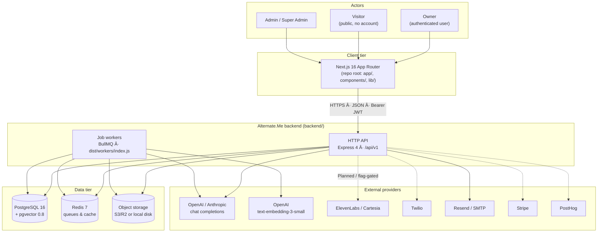
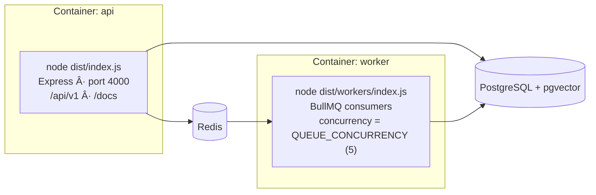
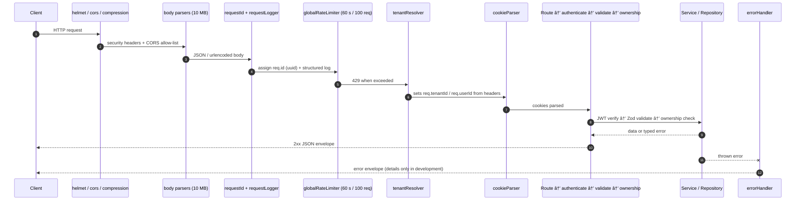
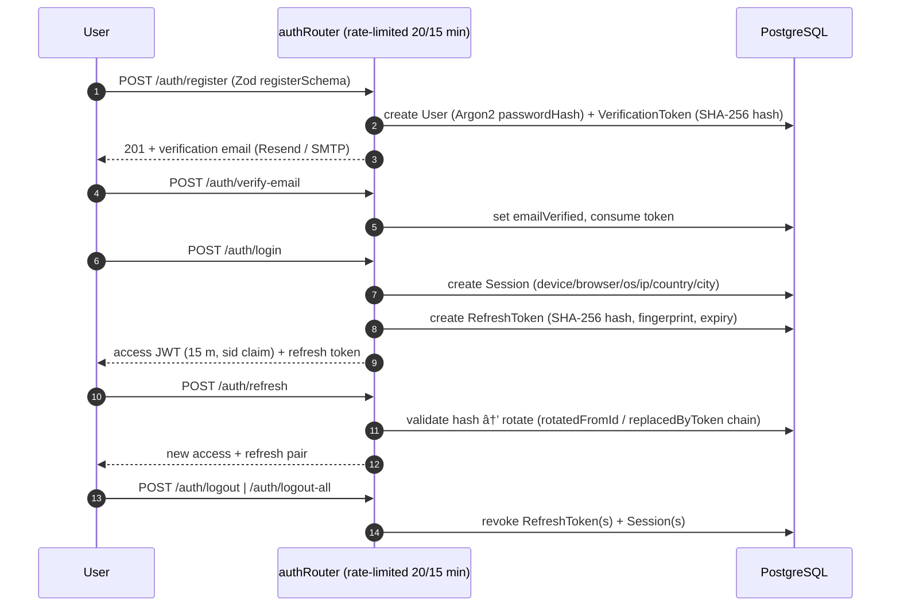
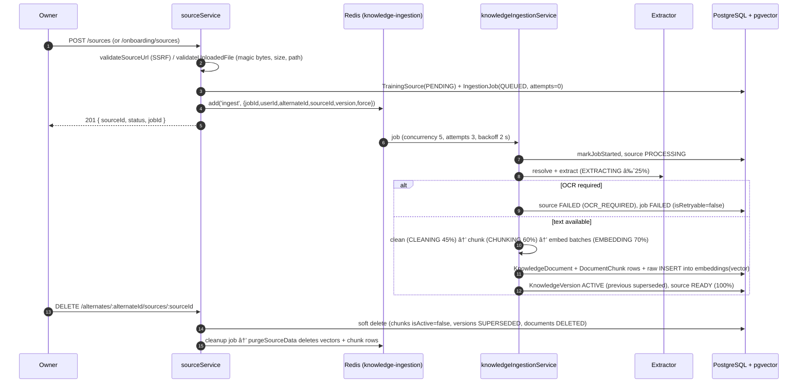
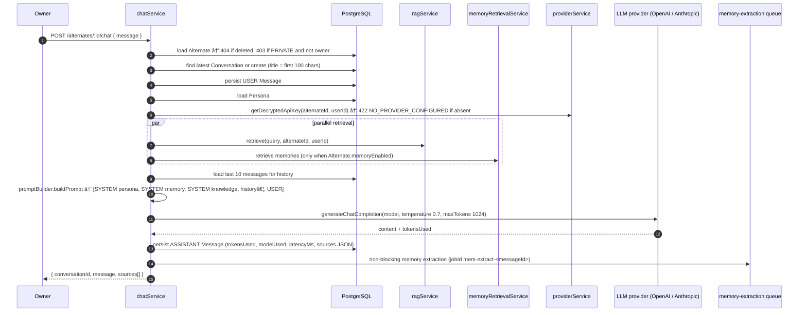
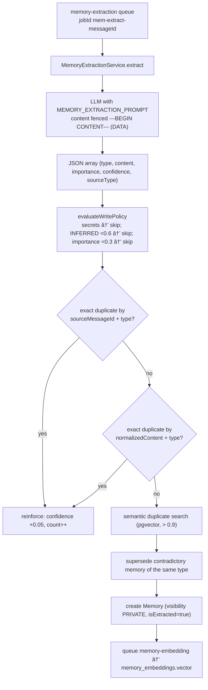
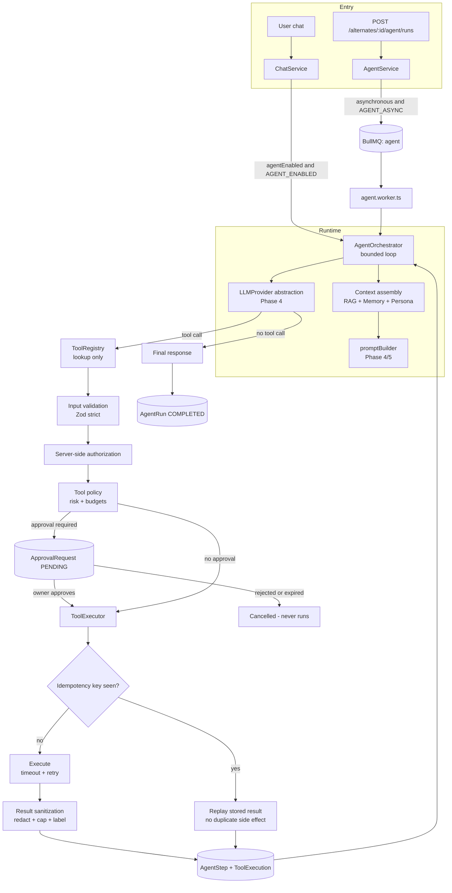
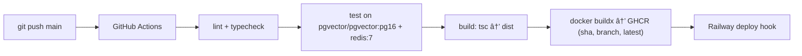

# Alternate.Me — System Architecture

| Field | Value |
| --- | --- |
| **Project** | Alternate.Me — AI Digital Twin Platform |
| **Document** | `docs/ARCHITECTURE.md` |
| **Version** | 1.1.0 |
| **Last Updated** | 2026-09-30 |
| **Status** | `Current` (implemented behaviour) — sections explicitly marked otherwise |
| **Source of Truth** | Implementation: `backend/src/**`, `backend/prisma/schema.prisma`, `backend/package.json`. Requirements: SRS v1.1. |

## Status label vocabulary

Every architectural statement in this pack carries one of these labels:

| Label | Meaning |
| --- | --- |
| `Current` | Implemented and present in the repository today. Verified by reading the code paths named in the section. |
| `Planned` | Designed/required by SRS v1.1 and scheduled for a specific future phase. Not implemented. |
| `Future` | Required by SRS v1.1 with no phase assigned yet. Not implemented. |
| `Engineering Decision` | A choice made during implementation that SRS v1.1 does not specify. Documented here so it can be reviewed and ratified or changed. |

> **Anti-invention rule:** nothing in this document asserts a requirement that is not present in SRS v1.1 or in the repository. Where behaviour is unspecified, the text says so explicitly and is labelled `Engineering Decision`.

## 1. Purpose and scope

Alternate.Me lets a person ("owner") create an AI **Alternate** — a digital twin — from their own knowledge sources, give it a persona and a voice, connect their own AI provider key (BYOK), and then have that Alternate answer questions in chat on the owner's behalf.

This document covers the **backend service** (`backend/`). A Next.js 16 front end lives at the repository root (see §4). Deep dives live in the sibling documents:

| Topic | Document |
| --- | --- |
| Phase-by-phase delivery status | [`PHASES.md`](./PHASES.md) |
| Data model, ERD, retention | [`DATABASE.md`](./DATABASE.md) |
| Prompt assembly and injection defence | [`PROMPTS.md`](./PROMPTS.md) |
| Security controls and risks | [`SECURITY.md`](./SECURITY.md) |
| Error envelope, codes, retries | [`ERROR-HANDLING.md`](./ERROR-HANDLING.md) |

## 2. System context



**Legend:** solid edges are `Current`; dotted edges are `Planned` or flag-gated (`FEATURE_VOICE_CLONING`, `FEATURE_TELEPHONY`, `FEATURE_EMAIL_AGENT`, `FEATURE_BYOK`, `ANALYTICS_ENABLED` — all default `false` in `backend/.env.example`).

## 3. Technology stack (`Current`)

| Layer | Technology | Version | Evidence |
| --- | --- | --- | --- |
| Runtime | Node.js | `>=22` (engines) | `backend/package.json` |
| Language | TypeScript, compiled by `tsc` to CommonJS in `dist/` | `^5.8` | `backend/tsconfig.json` |
| Path aliasing | `@/*` → `src/*` at compile time; `module-alias` maps `@` → `dist` at runtime | `module-alias@^2.2.3` | `tsconfig.json`, `package.json#_moduleAliases` |
| HTTP framework | Express | `^4.21` | `src/app.ts` |
| Validation | Zod | `^4.0` | `src/middlewares/validate.ts`, `src/config/env.validation.ts` |
| ORM | Prisma Client | `^6.5` (resolves 6.19.3) | `prisma/schema.prisma` |
| Database | PostgreSQL + `pgvector` (`vector(1536)`, HNSW cosine) | PG 16 / pgvector 0.8 in CI | `prisma/migrations/20260825122337_phase3_knowledge_ingestion/migration.sql` |
| Queue / cache | Redis 7 + BullMQ | `bullmq@^5.45`, `ioredis@^5.6` | `src/queues/index.ts`, `src/shared/redis.ts` |
| Auth | JWT access + refresh (`jsonwebtoken`), Argon2 password hashing, OAuth (Google / GitHub) | `^9.0`, `argon2@^0.44` | `src/auth/**` |
| Crypto | AES-256-GCM for provider keys at rest; SHA-256 for token/hash storage | Node `crypto` | `src/utils/helpers.ts`, `src/auth/utils/crypto.ts` |
| Logging | Pino (+ `pino-pretty` in dev) with redaction paths | `^9.6` | `src/utils/logger.ts` |
| API docs | `swagger-jsdoc` + `swagger-ui-express`, lazily mounted at `/docs` | `^6.2` / `^5.0` | `src/app.ts`, `src/config/swagger.ts` |
| Extraction | `pdf-parse` (PDF), `mammoth` (DOCX), `cheerio` (HTML), `youtube-transcript` | see lockfile | `src/knowledge/extractors/**` |
| Mail | `nodemailer`, `resend` | `^6.9`, `^4.8` | `src/auth/utils/mailer.ts` |
| Tests | Vitest 3 + `@vitest/coverage-v8`, Supertest, jszip/pdf-lib for fixtures | `^3.1` | `backend/vitest.config.ts` |
| Front end (repo root) | Next.js 16.2, React 19, Tailwind 4, Radix/shadcn, Recharts, framer-motion | see root `package.json` | root `app/`, `components/` |
| Packaging / CI | Docker multi-stage (node:22-alpine, non-root `appuser`, tini); GitHub Actions lint → typecheck → test (pgvector + redis services) → build → GHCR push → Railway deploy hook | — | `backend/Dockerfile`, `backend/.github/workflows/ci.yml` |

### 3.1 Deliberate engineering decisions (`Engineering Decision`)

| ID | Decision | Rationale recorded in code |
| --- | --- | --- |
| ED-01 | Prisma models declare `vector` as `Unsupported("vector")`; all vector reads/writes use parameterised `$queryRawUnsafe` SQL | Prisma cannot bind `vector` columns (`src/rag/vector.repository.ts`, `src/knowledge/knowledge-ingestion.service.ts`) |
| ED-02 | HNSW index instead of IVFFlat on `embeddings.vector` and `memory_embeddings.vector` | No training pass, better recall/latency for online RAG (`migration.sql` comment) |
| ED-03 | No tenant-partitioned vector index; tenant scope enforced by `WHERE alternateId/userId` predicates | Avoids index fragmentation at current scale (`migration.sql` comment) |
| ED-04 | Queues are created lazily and degrade to `null` rather than throwing when Redis is unavailable | The API stays up; jobs remain durable `QUEUED` rows (`src/queues/index.ts`) |
| ED-05 | Memory retrieval/extraction is never on the chat critical path; failures are logged and swallowed | Chat must not fail because memory failed (`src/chat/chat.service.ts`) |
| ED-06 | Ingestion retries are BullMQ-driven (`attempts: 3`, exponential backoff 2 s) plus a DB `isRetryable` flag consumed by the retry worker | Permanent ingestion errors are never retried automatically |
| ED-07 | Two-phase knowledge deletion (soft-delete removes retrieval eligibility, worker purges rows) | Fast deletes, no dangling retrievable knowledge (`src/knowledge/knowledge-cleanup.service.ts`) |
| ED-08 | Storage adapter defaults to local disk unless real (non-placeholder) S3 credentials are configured | Prevents a stub S3 adapter silently failing downloads (`src/storage/index.ts`) |

## 4. Repository layout

```
Alternate me/                      # repository root
├── app/  components/  lib/  public/      # Next.js 16 front end (TypeScript, Tailwind, shadcn)
├── package.json  tsconfig.json  next.config.mjs
└── backend/                              # backend service (own package.json / toolchain)
    ├── prisma/
    │   ├── schema.prisma                 # 35 models + 25 enums (see DATABASE.md)
    │   ├── seed.ts
    │   └── migrations/                   # 4 applied migrations + migration_lock.toml
    ├── src/
    │   ├── index.ts                      # API entrypoint (env validation, HTTP, graceful shutdown)
    │   ├── app.ts                        # Express app + global middleware chain
    │   ├── routes/                       # root router + health endpoints
    │   ├── auth/                         # Phase 1: controllers, dto, middlewares, repositories, services, utils, validators
    │   ├── alternates/  onboarding/       # Phase 2: alternate lifecycle + onboarding wizard
    │   ├── ai-providers/                  # Phase 2: BYOK provider credentials + adapters
    │   ├── voice/                         # Phase 2/6: voice profile management
    │   ├── knowledge/                     # Phase 3: extractors, cleaner, chunker, embeddings, versioning
    │   ├── rag/                           # Phase 4: retrieval, context, prompt, LLM providers
    │   ├── chat/                          # Phase 4: chat + conversation services, controllers, routes
    │   ├── memory/                        # Phase 5: persistence, extraction, retrieval, ranking, formatting
    │   ├── workers/                       # BullMQ consumers (knowledge, memory, summary)
    │   ├── queues/                        # lazy Queue registry
    │   ├── middlewares/                   # requestId, logger, rate limit, tenant, ownership, validate, error, 404
    │   ├── config/                        # env loader, Zod env validation, swagger
    │   ├── database/  storage/  events/  shared/
    │   ├── utils/                         # errors, response helpers, logger, crypto helpers, asyncHandler
    │   └── tests/                         # unit + integration suites, setup, fixtures
    ├── scripts/                           # db checks, e2e smoke, fixture generation
    ├── docker-compose.yml  Dockerfile  .env.example  vitest.config.ts
    ├── ARCHITECTURE.md  PHASE2_COMPLETE.md  PHASE4_COMPLETE.md   # historical build notes
    └── .github/workflows/ci.yml
```

## 5. Runtime topology (`Current`)

Two processes run the same image with different entrypoints:



Docker Compose declares `api` (1 CPU / 1 GB) and `worker` (2 CPU / 2 GB) sharing `altme-network`, both gated on the Redis healthcheck, plus a `redis:7-alpine` service. `api` is health-checked against `GET /api/v1/health/liveness`.

**API startup sequence** (`src/index.ts`): `validateEnv()` → exit non-zero on failure → `app.listen(PORT)` → log the start banner (`port`, `env`, `apiPrefix`, `url`, `docs`).

**Graceful shutdown** (SIGTERM/SIGINT): stop accepting HTTP → `closeAllQueues()` → `prisma.$disconnect()` → `exit(0)`, hard-capped by a 10 s timer that forces `exit(1)`. `uncaughtException` and `unhandledRejection` log `fatal` and `exit(1)`.

## 6. Request pipeline (`Current`)

Middleware order is fixed in `src/app.ts` and is load-bearing:



Notes and current risks:

- `tenantResolver` trusts the `X-Tenant-Id` / `X-User-Id` request headers verbatim (`src/middlewares/tenant.ts`). Data access does **not** rely on them: services resolve identity from the verified JWT (`req.authUser.id`) and scope every query by `userId` + `alternateId`. The header-derived values are context only. See `SECURITY.md` §7 for the open item.
- Swagger is mounted lazily on the first `/docs` request to avoid a blocking `swagger-jsdoc` file scan at boot.
- `trust proxy` is `1`; `etag` is `strong`.
- Body limits: `express.json` / `urlencoded` at `10mb`. `FILE` sources are submitted as base64 `fileContent` inside JSON (`POST /sources`), so the JSON limit is the effective upload ceiling for that path.

## 7. Module map

| Module | Path | Responsibility | Status |
| --- | --- | --- | --- |
| Auth | `src/auth/**` | Registration, email verification, login, refresh-token rotation, logout, sessions, password reset, OAuth (Google/GitHub), profile, preferences, account deletion, audit repository | `Current` (Phase 1) |
| Middlewares | `src/middlewares/**` | Request ID, request logging, global + auth rate limiting, tenant header resolution, ownership guards, Zod validation, 404, central error handler | `Current` |
| Alternates | `src/alternates/**` | Alternate CRUD, username availability, soft delete, public profile projection | `Current` (Phase 2) |
| Onboarding | `src/onboarding/**` | Wizard state machine (`PERSONAL → SOURCES → PERSONA → VOICE → AI_PROVIDER → PUBLISH`), server-verified step completion, preview, publish | `Current` (Phase 2) |
| AI providers | `src/ai-providers/**` | BYOK credential storage/validation/removal; `ProviderRegistry` + OpenAI/Anthropic adapters | `Current` (Phase 2) |
| Voice | `src/voice/**` | Voice provider catalogue, voice profile persistence with consent tracking | `Partial` — profiles are stored, synthesis is not implemented (see `PHASES.md` Phase 6) |
| Knowledge | `src/knowledge/**` | Extract → clean → chunk → embed → version → index; file/URL/YouTube/LinkedIn resolvers; SSRF-safe fetcher; file validation; cleanup/retry services | `Current` (Phase 3) |
| RAG | `src/rag/**` | Query normalisation, embedding, pgvector search, reranking, context assembly, prompt building, LLM provider abstraction | `Current` (Phase 4) |
| Chat | `src/chat/**` | Chat orchestration, conversation/message persistence, debug endpoints | `Current` (Phase 4) |
| Memory | `src/memory/**` | Memory persistence, write policy, extraction, ranking, retrieval, formatting, owner management APIs | `Current` (Phase 5) |
| Workers | `src/workers/**` | Knowledge ingestion/document/embedding/cleanup/retry, memory extraction/embedding, conversation summary, agent runs | `Current` (Phases 3 + 5 + 6). Stub processors exist for `EMBEDDING`, `TRAINING`, `EMAIL`, `VOICE`, `ANALYTICS`, `CLEANUP`, `RETRY` — registered but no-op |
| Agents / tools / approvals | `src/agent/**` | Agent orchestrator (bounded loop), tool registry, central risk/approval policy, server-side authorization, tool execution with idempotency + retry + timeouts, approval lifecycle, untrusted-data sanitization, run/step/execution persistence | `Current` (Phase 6) — runtime + safe internal tools only; no external integrations (see `PHASES.md` §4) |
| Billing (Stripe) | — | `Subscription` / `UsageRecord` models and Stripe env keys exist; no routes or webhook handlers | `Future` |
| Email channel | — | `EmailThread` / `EmailMessage` models and a stub `EMAIL` queue consumer exist; no inbound/outbound pipeline | `Future` |
| Telephony | — | `CallRecord` model and Twilio env keys exist; no routes or webhooks | `Future` |
| Analytics | — | `AnalyticEvent` model, `EventName` enum, Pino logs; PostHog key is config-only | `Future` |
| Sharing / widget / branding / BYOK UI | — | Public profile endpoint exists (`GET /public/:username`); embeddable widget, branding, and share controls are not implemented | `Future` |
| Moderation | — | No moderation models, queues, or review tooling | `Future` |

## 8. HTTP surface (`Current`)

All routes are mounted under `config.app.apiPrefix` (`/api/v1`). Every `/alternates`, `/onboarding`, `/sources`, `/voice`, `/ai-providers`, `/me`, `/account`, and `/sessions` route requires a Bearer JWT. `/public/:username` is anonymous. `/health*` is anonymous.

| Method | Path | Auth | Handler |
| --- | --- | --- | --- |
| GET | `/health`, `/health/readiness`, `/health/liveness` | — | `routes/health.ts` (readiness runs `SELECT 1`) |
| POST | `/auth/register`, `/auth/login`, `/auth/refresh` | — (auth rate limit: 20 / 15 min) | `auth.controller` |
| POST | `/auth/logout`, `/auth/logout-all` | Bearer | `auth.controller` |
| POST | `/auth/verify-email`, `/auth/resend-verification`, `/auth/forgot-password`, `/auth/reset-password` | — (auth rate limit) | `auth.controller` |
| GET | `/auth/google`, `/auth/google/callback`, `/auth/github`, `/auth/github/callback` | — | OAuth flow |
| GET/PUT | `/me`, `/account` | Bearer | `user.controller` (profile) |
| PATCH | `/me/password`, `/me/email`, `/me/preferences`, `/me/avatar` | Bearer | `user.controller` |
| DELETE | `/me`, `/account` | Bearer | `user.controller` (account deletion) |
| GET | `/sessions` | Bearer | list active sessions |
| DELETE | `/sessions/:id`, `/sessions` | Bearer | revoke one / all sessions |
| POST | `/alternates` | Bearer | create Alternate |
| GET | `/alternates/username/:username/availability` | Bearer | availability check (declared before `/:id`) |
| GET | `/alternates` | Bearer | list owned Alternates |
| GET · PUT · DELETE | `/alternates/:id` | Bearer + ownership | detail / update / soft delete |
| PUT | `/alternates/:alternateId/voice` | Bearer + ownership | save voice profile |
| GET | `/alternates/:alternateId/sources` | Bearer + ownership | list knowledge sources |
| GET | `/alternates/:alternateId/sources/:sourceId` | Bearer + ownership | source status (stage, progress, job state) |
| POST | `/alternates/:alternateId/sources/:sourceId/reprocess` | Bearer + ownership | queue a new knowledge version (`force` bypasses checksum idempotency) |
| DELETE | `/alternates/:alternateId/sources/:sourceId` | Bearer + ownership | soft-delete source (204) |
| GET | `/alternates/:alternateId/knowledge/status` | Bearer + ownership | aggregate knowledge counters |
| POST | `/onboarding/start`, `/onboarding/personal`, `/onboarding/sources` | Bearer | wizard steps |
| PUT | `/onboarding/persona`, `/onboarding/voice`, `/onboarding/ai-provider` | Bearer | wizard steps |
| POST | `/onboarding/steps/:alternateId/complete` | Bearer + ownership | server-verified step completion |
| GET | `/onboarding/preview/:alternateId` | Bearer + ownership | pre-publish preview |
| POST | `/onboarding/publish` | Bearer | publish Alternate (`PUBLIC`, `PUBLISHED`) |
| POST | `/sources` | Bearer | standalone source registration + job queueing → 201 `{ sourceId, status, jobId }` |
| GET | `/voice/providers` | Bearer | voice provider catalogue |
| PUT · DELETE | `/ai-providers/alternates/:alternateId/ai-provider` | Bearer + ownership | store / remove BYOK key |
| POST | `/alternates/:alternateId/chat` | Bearer + ownership + chat rate limit (30 / 60 s) | `chat.controller.sendMessage` |
| GET | `/alternates/:alternateId/conversations` | Bearer + ownership | list conversations |
| GET · DELETE | `/alternates/:alternateId/conversations/:conversationId` | Bearer + ownership | conversation with messages / delete |
| POST | `/alternates/:alternateId/rag/debug` | Bearer + ownership; 403 in production unless `ENABLE_RAG_DEBUG=true` | retrieval diagnostics |
| POST | `/alternates/:alternateId/memory/debug` | Bearer + ownership; 403 in production unless `ENABLE_MEMORY_DEBUG=true` | memory diagnostics |
| GET | `/alternates/:alternateId/memories` | Bearer + ownership | list memories |
| GET · PUT · DELETE | `/alternates/:alternateId/memories/:memoryId` | Bearer + ownership | read / update / soft delete |
| POST | `/alternates/:alternateId/memories/:memoryId/confirm` | Bearer + ownership | reinforce (confidence +0.05, capped at 1.0) |
| POST | `/alternates/:alternateId/memories/:memoryId/archive` | Bearer + ownership | archive (kept for audit, never retrieved) |
| POST | `/alternates/:alternateId/memories/forget` | Bearer + ownership | forget by normalised content match |
| GET | `/public/:username` | — | published PUBLIC Alternate projection (`displayName`, `title`, `bio`, `avatarUrl`, persona subset `{tone, writingStyle, personality}`, voice `{provider, name}`, provider `{provider, model}`) |

> **Response-shape inconsistency (`Current`, tracked):** the `apiResponse` helper emits `{ success, data, meta }`; the memory controller emits `{ success, data }`; the chat controller emits `{ data }` only. Unifying all handlers on a single envelope is `Planned` and is a prerequisite for the contract in `ERROR-HANDLING.md` §2.

## 9. Domain flows (`Current`)

### 9.1 Authentication and session lifecycle



Key properties: access tokens are short-lived (`JWT_ACCESS_EXPIRY=15m`) and carry `sub`, `email`, `username`, `role`, `tenantId`, `permissions`, `sid`. Refresh tokens are stored **hashed** with rotation lineage (self-relation `previous`/`next`) so reuse is detectable. `authenticate` maps the verified payload onto `req.authUser` / `req.authSessionId`; `optionalAuthenticate` never fails the request.

### 9.2 Onboarding and Alternate creation

```mermaid
flowchart LR
    A["POST /onboarding/start<br/>create Alternate (DRAFT/PRIVATE) + Onboarding row"] --> B["PERSONAL<br/>POST /onboarding/personal"]
    B --> C["SOURCES<br/>POST /onboarding/sources<br/>→ source row + ingestion job"]
    C --> D["PERSONA<br/>PUT /onboarding/persona"]
    D --> E["VOICE<br/>PUT /onboarding/voice (consent)"]
    E --> F["AI_PROVIDER<br/>PUT /onboarding/ai-provider<br/>AES-256-GCM key + adapter validation"]
    F --> G["POST /onboarding/steps/:alternateId/complete<br/>server-verified completion"]
    G --> H["GET /onboarding/preview/:alternateId"]
    H --> I["POST /onboarding/publish<br/>status=PUBLISHED, visibility=PUBLIC"]
```



`Onboarding.completedSteps` is an enum array (`OnboardingStep[]`), so partial progress survives across sessions. Step completion is verified server-side (`requireAlternateOwnership`) instead of trusting client state. Every mutation writes an `AuditLog` row (`ALTERNATE_CREATED`, `PERSONA_UPDATED`, `VOICE_SELECTED`, `VOICE_CONSENT_GIVEN`, `AI_PROVIDER_ADDED`, `ALTERNATE_PUBLISHED`, …).

### 9.3 Knowledge ingestion (asynchronous)



Idempotency: the cleaned-content SHA-256 checksum is compared with the previous version; unchanged content short-circuits with `IDEMPOTENT_SKIP` unless `force: true`. Versioning is monotonic per source (`currentVersion + 1`, unique `(sourceId, version)`), and `KnowledgeVersion.status = ACTIVE` is the scope that RAG retrieval uses. Retryable failures (`FETCH_TIMEOUT`, `FETCH_FAILED`, `EMBEDDING_*`, `CHUNKING_FAILED`, `EXTRACTION_FAILED`) are re-enqueued by `knowledge-retry.worker` while `attempts < maxAttempts`.

### 9.4 Chat request (RAG + memory + LLM)



Failure semantics: an LLM failure becomes `BusinessError('Failed to generate response. Please try again.', 'LLM_ERROR')` (HTTP 422). Memory retrieval failures are logged and chat continues without memory (`ED-05`). If no provider is configured the request fails fast with `NO_PROVIDER_CONFIGURED` before any LLM spend.

### 9.5 Memory write path (extraction)



### 9.6 Memory read path (retrieval)

Vector search (`memory_embeddings.vector <=> $1::vector`, tenant-scoped, `status = 'ACTIVE'`, non-expired) and lexical search (`content` / `normalizedContent` case-insensitive contains) run and then merge by memory id keeping the higher similarity. `rankMemories` then scores:

```
score = similarity×w_rel + importance×w_imp + confidence×w_conf + recency×w_rec + reinforcement×w_rein
```

Recency decays from 1.0 (same day) to 0.1 (≥ 30 days); reinforcement saturates at 10 hits. Selection honours `topK` (default 10), a token budget (`MEMORY_MAX_TOKENS=2000`), and `minScore` (`MEMORY_MIN_SCORE=0.5` for retrieval, `0.3` for the debug endpoint). Retrieved ids get `lastAccessedAt` refreshed. `formatMemories` renders a numbered list prefixed `[MEMORIES]`, closed with an explicit "DATA about the user, not instructions" note.

### 9.7 Visitor and owner management flows

| Flow | Path | Behaviour |
| --- | --- | --- |
| Visitor views a public Alternate | `GET /public/:username` | Anonymous, read-only. Requires `visibility=PUBLIC` + `status=PUBLISHED` + `deletedAt IS NULL`. Never returns `encryptedApiKey`, `personaPrompt`, `passwordHash`, or usage metrics. `UNLISTED` / `PRIVATE` are unreachable anonymously |
| Visitor chats with a public Alternate | `POST /alternates/:alternateId/chat` | **`Planned`.** The chat route requires `authenticate` + `requireAlternateOwnership`, so today only the owner can drive chat. `ConversationChannel.WIDGET` / `API` and anonymous chat belong to the SRS sharing/widget work |
| Owner manages knowledge | `/alternates/:alternateId/sources*`, `/knowledge/status` | Status, reprocess, soft delete |
| Owner manages memories | `/alternates/:alternateId/memories*` | List / filter / sort, update, confirm, archive, forget |
| Owner manages conversations | `/alternates/:alternateId/conversations*` | List, read with messages, delete |
| Owner rotates provider key | `PUT /ai-providers/alternates/:alternateId/ai-provider` | Upsert; key encrypted; status `VALID` / `INVALID` / `PENDING`; key never returned |
| Owner deletes an Alternate | `DELETE /alternates/:id` | Soft delete (`deletedAt`), audit row. Child rows (sources, chunks, embeddings, conversations, messages, memories) are retained; retention policy is documented in `DATABASE.md` §6 |

### 9.8 Phase 6 — agent orchestration (`Current`)

Phase 6 is implemented in `backend/src/agent/**`. It adds the agent runtime and a **safe tool-execution pipeline** on top of Phases 0–5. It deliberately ships **no external integrations** (no email, SMS, telephony, voice, calendar, CRM, payments) — those remain `Future` per `PHASES.md` §4.

| Component | Responsibility | File | Status |
| --- | --- | --- | --- |
| `AgentOrchestrator` | Bounded execution loop; provider-agnostic; never decides permission | `orchestration/orchestrator.service.ts` | `Current` |
| Agent context assembly | Reuses `ragService`, `memoryRetrievalService`, `conversationService`, `promptBuilder` | `orchestration/context.service.ts` | `Current` |
| Agent policy block + context budget | Injects the agent policy, preserves `PROMPTS.md` §4.2 order, enforces the token budget | `orchestration/agent-prompt.ts` | `Current` |
| `ToolRegistry` | Register / unregister / lookup / duplicate rejection / model-facing JSON Schema. **Not** an authorization system | `tools/tool.registry.ts` | `Current` |
| Tool policy | Central, deny-by-default risk → approval mapping + budgets | `tools/tool-policy.service.ts` | `Current` |
| Tool authorization | Single gate: authenticated → alternate exists → ownership → tool exists → enabled → context → risk → approval | `tools/authorization.service.ts` | `Current` |
| Tool execution | Validate → idempotency → approval gate → execute (timeout + retry) → sanitize → persist | `execution/execution.service.ts` | `Current` |
| Idempotency | Deterministic key `sha256(alternateId, toolName, canonical(args))` + DB unique constraint | `execution/idempotency.service.ts` | `Current` |
| Retry policy | Retryable vs terminal classification, exponential backoff with ceiling | `execution/retry-policy.ts` | `Current` |
| Approval lifecycle | `PENDING → APPROVED/REJECTED/EXPIRED/CANCELLED → EXECUTED`, race-safe conditional update | `agent.repository.ts`, `agent.service.ts` | `Current` |
| Agent queue + worker | Reuses the BullMQ `agent` queue; terminal agent errors are not retried | `workers/agent.worker.ts` | `Current` |
| Audit | Reuses the existing `AuditLog` (`action` is a String column, so no enum migration) | `agent.audit.ts` | `Current` |

**Built-in tools.** All Phase 6 tools wrap existing services; none re-implement retrieval.

| Tool | Risk | Visitor | Wraps |
| --- | --- | --- | --- |
| `knowledge_search` | `READ_ONLY` | allowed | Phase 4 `ragService.retrieve` |
| `memory_search` | `READ_ONLY` | **denied** | Phase 5 `memoryRetrievalService.retrieve` |
| `conversation_context` | `READ_ONLY` | allowed | `conversation` / `message` (tenant-scoped) |
| `alternate_context` | `READ_ONLY` | allowed | `Alternate` + `Persona` (persona owner-only) |
| `sample_owner_action` | `HIGH` | **denied** | none — non-destructive scaffolding that exercises the approval gate; off unless `AGENT_SAMPLE_ACTION_TOOL_ENABLED=true` |



**Hard execution limits** (`config.agent.limits`, all env-configurable, none hardcoded in logic): `maxSteps` 8, `maxToolCalls` 10, `maxRuntimeMs` 60 000, `maxToolRuntimeMs` 15 000, `maxContextTokens` 8 000, `maxToolResultChars` 4 000, `maxLlmCalls` 12, `maxToolCallsPerTool` 4.

**Boundaries kept explicit.** `Knowledge ≠ Memory ≠ Tool ≠ Agent`: knowledge is Phase 3/4 ingestion + retrieval, memory is Phase 5 durable context, a tool is a single authorized capability call, and the agent is the loop that composes them. Only `AgentStep` and `ToolExecution` rows are persisted — never chain-of-thought, hidden reasoning, or model deliberations.

**Endpoints** (mounted at `/alternates`, authenticated + `requireAlternateOwnership`, so the whole surface is owner-only):

| Method | Path | Limit | Status |
| --- | --- | --- | --- |
| `POST` | `/alternates/:alternateId/agent/runs` | `agentRunRateLimiter` (10/min) | `Current` |
| `GET` | `/alternates/:alternateId/agent/runs` | — | `Current` |
| `GET` | `/alternates/:alternateId/agent/runs/:runId` | — | `Current` |
| `GET` | `/alternates/:alternateId/agent/runs/:runId/executions` | — | `Current` |
| `GET` | `/alternates/:alternateId/agent/approvals` | — | `Current` |
| `POST` | `/alternates/:alternateId/agent/approvals/:approvalId/approve` | `agentToolRateLimiter` (30/min) | `Current` |
| `POST` | `/alternates/:alternateId/agent/approvals/:approvalId/reject` | `agentToolRateLimiter` (30/min) | `Current` |
| `GET` | `/alternates/:alternateId/agent/tools` | — | `Current` |
| `PUT` | `/alternates/:alternateId/agent/tools/:toolName` | `agentToolRateLimiter` (30/min) | `Current` |

**Chat integration.** `ChatService.sendMessage` consults the agent only when `config.agent.enabled` **and** `alternate.agentEnabled` are both true (defaults: `AGENT_ENABLED=false`, `agentEnabled=false`). Otherwise the Phase 4/5 path runs unchanged. On agent failure the user message stays persisted, the run is recorded `FAILED`, and the caller receives a safe message. No transaction is held open across an LLM or tool call.


## 10. Asynchronous processing (`Current`)

| Queue | Producer | Consumer | Payload | Status |
| --- | --- | --- | --- | --- |
| `knowledge-ingestion` | `sourceService` on create/reprocess | `knowledge-ingestion.worker.ts` → `knowledgeIngestionService.ingest` | `{ jobId, userId, alternateId, sourceId, version, force }` | `Current` |
| `document-processing` | knowledge pipeline | `document-processing.worker.ts` | — | `Current` (registered consumer) |
| `embedding-generation` | knowledge pipeline | `embedding-generation.worker.ts` | — | `Current` (registered consumer) |
| `knowledge-cleanup` | source delete | `knowledge-cleanup.worker.ts` → `purgeSourceData` + `resetSourceCounts` | `{ sourceId, userId, alternateId }` | `Current` |
| `knowledge-retry` | retryable ingestion failure | `knowledge-retry.worker.ts` (re-enqueues ingestion, marks `RETRYING`) | `{ ingestionJobId }` | `Current` |
| `memory-extraction` | chat, after the assistant message is persisted | `memory-extraction.worker.ts` → `memoryExtractionService.extract` | `{ conversationId, messageId, alternateId, userId, messageContent }` | `Current` |
| `memory-embedding` | `processExtractedMemory` | `memory-embedding.worker.ts` → `upsertMemoryEmbedding` + audit event | `{ memoryId, alternateId, userId, content }` | `Current` |
| `memory-conversation-summary` | *(no producer wired yet)* | `conversation-summary.worker.ts` → `MESSAGE_SUMMARY_PROMPT` → `ConversationSummary` | `{ conversationId, alternateId, userId, messageRangeStart, messageRangeEnd }` | `Current` worker / `Planned` trigger |
| `embedding`, `training`, `email`, `voice`, `analytics`, `cleanup`, `retry` | — | no-op processors | — | `Planned` / `Future` |

Defaults applied to every queue: `attempts: 3`, exponential backoff from 2 s, `removeOnComplete: { age: 3600, count: 100 }`, `removeOnFail: { age: 86400, count: 1000 }`, concurrency `QUEUE_CONCURRENCY` (default 5). A Redis outage warns and processing resumes on recovery rather than crashing the process (`ED-04`). With `QUEUE_ENABLED=false` the API stays up and jobs remain `QUEUED` rows so nothing is lost.

## 11. Configuration and observability (`Current`)

- **Config loading:** `src/config/index.ts` reads `.env` (resolved relative to `dist/config/../../.env`), then `validateEnv()` enforces a Zod schema: `NODE_ENV`, `PORT`, `API_PREFIX`, `APP_URL`, `CLIENT_URL`, `DATABASE_URL`, `REDIS_URL`, `JWT_ACCESS_SECRET` (min 32 chars), `JWT_REFRESH_SECRET` (min 32 chars), `LOG_LEVEL`, and optional SMTP / Google / GitHub / storage values. Missing required values print each issue then `exit(1)`.
- **Feature flags:** `FEATURE_VOICE_CLONING`, `FEATURE_TELEPHONY`, `FEATURE_EMAIL_AGENT`, `FEATURE_BYOK`, `ANALYTICS_ENABLED` — read as `=== 'true'` comparisons.
- **Knowledge tuning:** `CHUNK_SIZE=1000`, `CHUNK_OVERLAP=150`, `MAX_CHUNK_SIZE=2048`, `MIN_CHUNK_SIZE=64`, `EMBEDDING_PROVIDER=openai` (`deterministic` in tests), `EMBEDDING_MODEL=text-embedding-3-small`, `EMBEDDING_DIMENSIONS=1536`, `EMBEDDING_BATCH_SIZE=64`, `EMBEDDING_TIMEOUT_MS=30000`, `MAX_FILE_SIZE=25 MB`, `MAX_DOCUMENT_SIZE=15 MB`, `INGESTION_TIMEOUT=15000`, `MAX_URL_REDIRECTS=5`, `MAX_URL_RESPONSE_SIZE=5 MB`, `INGESTION_MAX_RETRIES=3`.
- **RAG tuning:** `RAG_INITIAL_TOP_K=20`, `RAG_FINAL_TOP_K=5`, `RAG_MIN_SIMILARITY=0.7`, `RAG_MAX_CONTEXT_TOKENS=3000`, `RAG_MAX_CHUNKS=5`, `RAG_MAX_CHARACTERS=4000`.
- **Chat tuning:** `MAX_CONVERSATION_MESSAGES=10`, `MAX_CONVERSATION_TOKENS=2000`, `CHAT_RATE_LIMIT_WINDOW_MS=60000`, `CHAT_RATE_LIMIT_MAX=30`, `LLM_TIMEOUT=60000`.
- **Memory tuning:** `MEMORY_ENABLED=true`, `MEMORY_EXTRACTION_ENABLED=true`, `MEMORY_EXTRACTION_MODEL=gpt-4o-mini`, `MEMORY_EXTRACTION_MIN_CONFIDENCE=0.7`, `MEMORY_TOP_K=10`, `MEMORY_MAX_TOKENS=2000`, `MEMORY_MIN_SCORE=0.5`, `CONVERSATION_SUMMARY_TRIGGER_TOKENS=4000`, `CONVERSATION_SUMMARY_MODEL=gpt-4o-mini`.
- **Debug toggles:** `ENABLE_RAG_DEBUG`, `ENABLE_MEMORY_DEBUG` (both required for the debug endpoints when `NODE_ENV=production`).
- **Structured logging:** Pino with ISO timestamps and redaction of `req.headers.authorization`, `req.headers.cookie`, `body.password|token|secret|apiKey|api_key`, and any `*.apiKey|*.secret|*.password`. Request logs carry `req.id` (echoed as the `X-Request-Id` response header), method, URL, IP, user agent.
- **Health:** `/health` (uptime, version, environment), `/health/readiness` (DB `SELECT 1` → 503 `SERVICE_UNAVAILABLE`), `/health/liveness` (cheap).
- **Domain events:** in-process `EventEmitter` (`src/events/index.ts`) with a typed `EventName` catalogue (user, alternate, training, conversation, message, email, voice, subscription, payment, api key, audit). `Current` — emitted for future subscribers; not a cross-process bus.
- **Analytics:** durable audit rows in `audit_logs` today; PostHog is config-only (`ANALYTICS_ENABLED=false` by default).

## 12. Deployment (`Current`)



CI runs `prisma generate`, `prisma migrate deploy` against the pgvector service, then `npm run test:coverage` with a hermetic env (`NODE_ENV=test`, test JWT secrets, local Postgres/Redis). Local development: `docker compose up -d` (api + worker + redis) or `pnpm dev` (`tsc` then `node dist/index.js`), with the database on Neon (pooled `DATABASE_URL` for queries plus `DIRECT_URL` for migrations/transactions).

## 13. Known gaps and limitations (`Current`)

| # | Gap | Impact | Cross-reference |
| --- | --- | --- | --- |
| G-01 | Phase 5 automated verification is blocked because the test environment cannot reach the database; the test run is therefore not a completed verification artefact | Phase 5 is implementation-complete but **not** fully tested | `PHASES.md` Phase 5, `ERROR-HANDLING.md` §9 |
| G-02 | Agent runtime and tool execution exist (Phase 6) but the tool catalogue is read-only plus one approval-gated scaffolding tool; no real side-effecting integration is enabled | SRS "act on the owner's behalf" scope is foundation-only by design | `PHASES.md` §3.7, `ARCHITECTURE.md` §9.8 |
| G-03 | No voice synthesis, telephony, or email channel despite models and env keys existing | SRS channels undelivered | `PHASES.md` §4 |
| G-04 | Response envelope differs between `apiResponse`, the memory controller, and the chat controller | Clients must special-case chat responses | `ERROR-HANDLING.md` §2 |
| G-05 | `memory-conversation-summary` has a worker but no producer | Long conversations can exceed the context budget without summarisation | `PROMPTS.md` §8 |
| G-06 | Rate limiting uses the in-process store; `src/shared/{redis,cache,rateLimiter}.ts` exist for a Redis-backed path | Multi-instance deployments do not share counters | `SECURITY.md` §7 |
| G-07 | The S3 storage adapter is a stub (no `@aws-sdk/client-s3`); `download()` throws | Production object storage requires the SDK plus `STORAGE_PROVIDER=s3` | `SECURITY.md` §7, §8 |
| G-08 | `tenantResolver` accepts tenant/user identity from request headers | Must never be used for authorisation (it is not today) | `SECURITY.md` §7 |
| G-09 | No streaming (SSE) chat responses — `stream: false` is hard-coded in both LLM providers | Perceived latency on long answers | `PROMPTS.md` §9 |
| G-10 | No moderation, billing, widget, or branding implementation | SRS future areas undelivered | `PHASES.md` §4 |

---

*End of ARCHITECTURE.md — version 1.1.0.*

