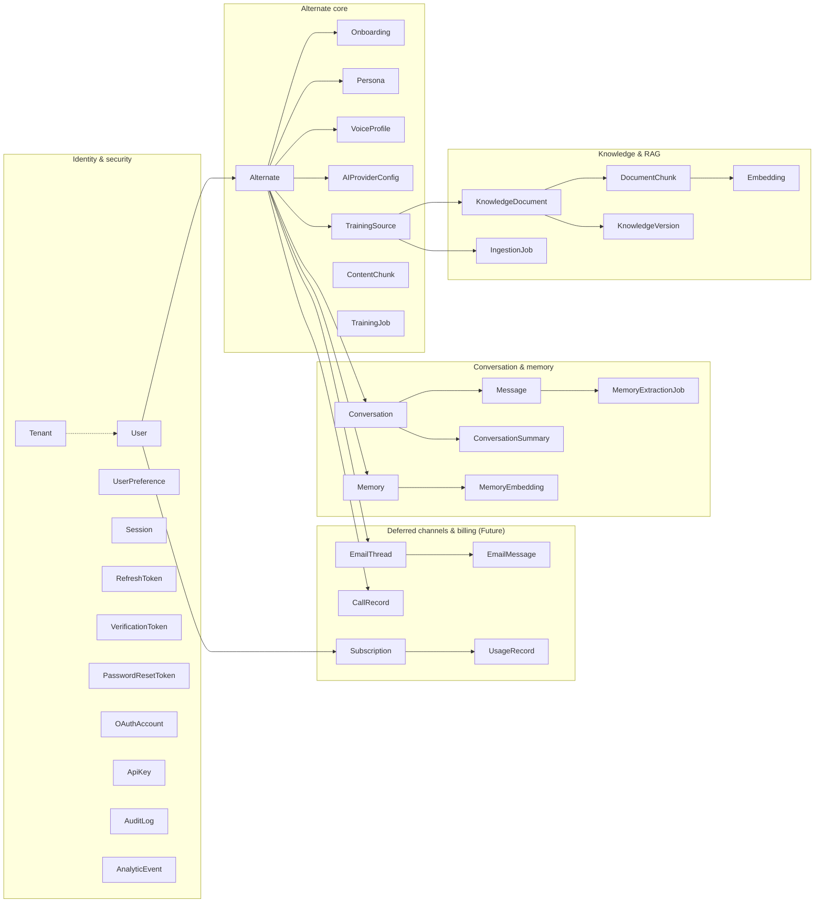

# Alternate.Me — Database Reference

| Field | Value |
| --- | --- |
| **Project** | Alternate.Me — AI Digital Twin Platform |
| **Document** | `docs/DATABASE.md` |
| **Version** | 1.1.0 |
| **Last Updated** | 2026-09-30 |
| **Status** | `Current` — derived directly from `backend/prisma/schema.prisma` and the five migrations (migration 5 authored but **not yet applied**: the Neon host was unreachable from the build environment) |
| **Source of Truth** | `backend/prisma/schema.prisma` (models, fields, defaults, indexes) and `backend/prisma/migrations/**` (physical DDL). If this document and the schema disagree, **the schema wins** |

## 1. Datasource, generator and extensions

```prisma
generator client {
  provider        = "prisma-client-js"
  previewFeatures = ["fullTextSearchPostgres"]
}

datasource db {
  provider  = "postgresql"
  url       = env("DATABASE_URL")   // pooled connection (PgBouncer) for runtime queries
  directUrl = env("DIRECT_URL")     // direct connection for migrations and transactions
}
```

- **Engine:** PostgreSQL. CI and local compose use `pgvector/pgvector:pg16`; production runs Neon PostgreSQL with pgvector 0.8 available.
- **Extension:** `vector`, created idempotently by the Phase 3 migration (`CREATE EXTENSION IF NOT EXISTS vector;`). Without it, vector columns and HNSW indexes cannot be created.
- **Preview feature:** `fullTextSearchPostgres` is enabled on the generator. No `@@fulltext` index is declared today, so the flag is currently unused (`Engineering Decision`: retained for planned lexical-search improvements).
- **Vector columns are `Unsupported("vector")`** on `Embedding.vector` and `MemoryEmbedding.vector`. Prisma Client cannot bind them, so all vector reads/writes go through parameterised `$queryRawUnsafe` / `$executeRawUnsafe` SQL (`src/rag/vector.repository.ts`, `src/memory/memory.repository.vector.ts`, `src/knowledge/knowledge-chunk.repository.ts`, `src/knowledge/knowledge-cleanup.service.ts`).
- **Dimensions:** `vector(1536)` for both vector tables, matching `EMBEDDING_DIMENSIONS=1536` and `text-embedding-3-small`. `Embedding.modelDimensions` (default 1536) and `MemoryEmbedding.dimensions` (default 1536) record per-row model dimensions, so a future model change is detectable rather than silently corrupting retrieval.

## 2. Conventions applied across the schema

| Convention | Rule | Notes |
| --- | --- | --- |
| Primary keys | `String @id @default(uuid()) @db.Uuid` | Application-generated UUIDs; no integer sequences |
| Table naming | `@@map("snake_case_plural")` | `model User → users`, `model MemoryExtractionJob → memory_extraction_jobs` |
| Timestamps | `createdAt @default(now())`, `updatedAt @updatedAt` | Soft-delete/state markers are nullable `DateTime?` (`deletedAt`, `revokedAt`, `consumedAt`, `supersededAt`, `failedAt`, `processedAt`, `publishedAt`) |
| Tenant scoping | Child models carry `userId` and, where the hierarchy requires it, `alternateId` | Enforced in application queries, not by row-level security. See §9 |
| Referential integrity | `onDelete: Cascade` from `User`/`Alternate`/parent rows | Exceptions: `IngestionJob.document`, `UsageRecord.subscription`, and `Memory.supersededBy` (`SET NULL`) |
| Enums | Native PostgreSQL enums generated from `enum` blocks | 25 enums — listed in §5 |
| Indexes | Explicit `@@index` on every foreign key used for filtering, plus status/date columns used by list APIs | Full list per model in §4 |
| Uniqueness | `@unique` / `@@unique` only for real business invariants | e.g. `User.username`, `User.email`, `Alternate.username`, one-per-Alternate rows (`Onboarding`, `Persona`, `VoiceProfile`, `AIProviderConfig`), `ApiKey.keyHash` |
| JSON payloads | `Json?` for extensibility (`metadata`, `settings`, `scopes`, `properties`, `payload`, `result`) | Never for data that must be queried or constrained |
| Money | `Decimal @db.Decimal(10, 4)` (`CallRecord.cost`) | The only monetary column in the schema |
| Scores | `Float` with 0–1 semantics (`Memory.importance`, `Memory.confidence`) | Validated in `memory.policy.ts` before write |

## 3. Entity-relationship diagram

Full ERD (40 models). Relations follow the foreign keys declared in the schema.

```mermaid
erDiagram
    Tenant ||--o{ User : tenantId
    Tenant ||--o{ Session : tenantId
    Tenant ||--o{ AuditLog : tenantId
    User ||--o| UserPreference : userId
    User ||--o{ Session : userId
    User ||--o{ RefreshToken : userId
    User ||--o{ VerificationToken : userId
    User ||--o{ PasswordResetToken : userId
    User ||--o{ OAuthAccount : userId
    User ||--o{ Alternate : userId
    User ||--o{ Conversation : userId
    User ||--o{ TrainingSource : userId
    User ||--o{ KnowledgeDocument : userId
    User ||--o{ DocumentChunk : userId
    User ||--o{ Embedding : userId
    User ||--o{ IngestionJob : userId
    User ||--o{ KnowledgeVersion : userId
    User ||--o{ Memory : userId
    User ||--o{ MemoryEmbedding : userId
    User ||--o{ ConversationSummary : userId
    User ||--o{ MemoryExtractionJob : userId
    User ||--o{ AuditLog : userId
    User ||--o{ AnalyticEvent : userId
    User ||--o{ ApiKey : userId
    User ||--o{ Subscription : userId
    User ||--o{ UsageRecord : userId
    User ||--o{ EmailThread : userId
    User ||--o{ CallRecord : userId
    User ||--o{ TrainingJob : userId
    User ||--o{ VoiceProfile : userId
    Alternate ||--o| Onboarding : alternateId
    Alternate ||--o| Persona : alternateId
    Alternate ||--o| VoiceProfile : alternateId
    Alternate ||--o| AIProviderConfig : alternateId
    Alternate ||--o{ TrainingSource : alternateId
    Alternate ||--o{ ContentChunk : alternateId
    Alternate ||--o{ TrainingJob : alternateId
    Alternate ||--o{ KnowledgeDocument : alternateId
    Alternate ||--o{ DocumentChunk : alternateId
    Alternate ||--o{ Embedding : alternateId
    Alternate ||--o{ IngestionJob : alternateId
    Alternate ||--o{ KnowledgeVersion : alternateId
    Alternate ||--o{ Conversation : alternateId
    Alternate ||--o{ Memory : alternateId
    Alternate ||--o{ MemoryEmbedding : alternateId
    Alternate ||--o{ ConversationSummary : alternateId
    Alternate ||--o{ MemoryExtractionJob : alternateId
    Alternate ||--o{ EmailThread : alternateId
    Alternate ||--o{ CallRecord : alternateId
    TrainingSource ||--o{ ContentChunk : sourceId
    TrainingSource ||--o{ KnowledgeDocument : sourceId
    TrainingSource ||--o{ DocumentChunk : sourceId
    TrainingSource ||--o{ Embedding : sourceId
    TrainingSource ||--o{ IngestionJob : sourceId
    TrainingSource ||--o{ KnowledgeVersion : sourceId
    KnowledgeDocument ||--o{ DocumentChunk : documentId
    KnowledgeDocument ||--o{ Embedding : documentId
    KnowledgeDocument ||--o{ IngestionJob : documentId
    KnowledgeDocument ||--o| KnowledgeVersion : documentId
    DocumentChunk ||--o{ Embedding : chunkId
    Conversation ||--o{ Message : conversationId
    Conversation ||--o| ConversationSummary : conversationId
    Conversation ||--o{ MemoryExtractionJob : conversationId
    Message ||--o{ MemoryExtractionJob : messageId
    Memory ||--o| MemoryEmbedding : memoryId
    Memory ||--o| Memory : supersededById
    Session ||--o{ RefreshToken : sessionId
    RefreshToken ||--o| RefreshToken : rotatedFromId
    EmailThread ||--o{ EmailMessage : threadId
    Subscription ||--o{ UsageRecord : subscriptionId
```



### 3.1 Domain views

The same 40 models grouped by bounded context. Arrows show the ownership edges that drive `Cascade` deletes: every domain root hangs off `User` (owner) or `Alternate`.



- **Identity & security** — `DATABASE.md` §4.1. All rows cascade from `User` (and optionally `Tenant`).
- **Alternate core** — §4.2. `Alternate` is the aggregate root; `TrainingSource` is the bridge into knowledge.
- **Knowledge & RAG** — §4.3. Chunks and embeddings are versioned; `IngestionJob` records pipeline runs.
- **Conversation & memory** — §4.4–§4.5. Messages feed extraction jobs; memories own one embedding each.
- **Deferred channels & billing** — §4.6. Provisioned for SRS areas not yet implemented (`Future`).

## 4. Model catalogue

Notation: **Tenant** = the scope predicate that must always be applied when querying the model; **Lifecycle** = how rows are created, changed and removed; **Sensitive** = fields needing encryption, hashing, redaction or special handling.

### 4.1 Identity, tenancy and security

#### `Tenant` → `tenants`

- **Purpose:** optional multi-tenant container (`Tenant` rows are referenced by `User.tenantId`, `Session.tenantId`, `AuditLog.tenantId`). No route currently creates or manages Tenants, so the table is present-but-unused in the product flow (`Engineering Decision`: kept as a forward-compatible seam; single-tenant deployments leave `tenantId` null).
- **Tenant:** root of the hierarchy.
- **Key fields:** `id` (uuid PK), `name`, `slug` (unique), `domain` (unique, optional), `metadata` (Json), `createdAt`, `updatedAt`.
- **Relations:** `users[]`, `sessions[]`, `auditLogs[]`.
- **Constraints & indexes:** unique `slug`, unique `domain`, `@@index([slug])`.
- **Lifecycle:** created out of band. Deleting a Tenant cascades to its users/sessions/audit rows.
- **Sensitive:** none.

#### `User` → `users`

- **Purpose:** the platform account — owner of Alternates, subject of settings, sessions and audit history.
- **Tenant:** `tenantId` (nullable FK to `Tenant`); identity is established from the verified JWT, and all descendant queries filter by `userId`.
- **Key fields:** `id` (uuid PK); `username` (unique), `email` (unique), `emailVerified` (DateTime?), `name`, `avatarUrl`, `role` (`UserRole`, default `USER`), `passwordHash` (nullable — OAuth-only accounts have none), `isMfaEnabled` (default false), `mfaSecret`, `bio`, `timezone` (default `UTC`), `language` (default `en`), `theme` (default `light`), `lastLoginAt`, `isActive` (default true), `deletedAt`, `metadata` (Json), timestamps.
- **Relations:** `preferences` (1:1 `UserPreference`), `alternates[]`, `sessions[]`, `refreshTokens[]`, `verificationTokens[]`, `passwordResetTokens[]`, `oauthAccounts[]`, `apiKeys[]`, `auditLogs[]`, `analytics[]`, `subscriptions[]`, `usageRecords[]`, `conversations[]`, `knowledgeDocuments[]`, `documentChunks[]`, `embeddings[]`, `knowledgeJobs[]`, `knowledgeVersions[]`, `trainingSources[]`, `trainingJobs[]`, `memories[]`, `memoryEmbeddings[]`, `memoryExtractionJobs[]`, `conversationSummaries[]`, `emailThreads[]`, `callRecords[]`, `onboardings[]`, `personas[]`, `voiceProfiles[]`, `tenant`.
- **Constraints & indexes:** `username` unique, `email` unique (both also indexed explicitly); `@@index([role])`, `@@index([tenantId])`, `@@index([deletedAt])`.
- **Lifecycle:** created by `POST /auth/register` or first OAuth sign-in; `emailVerified` set by `POST /auth/verify-email`; `lastLoginAt` on login; soft delete (`deletedAt`) or hard delete via account deletion; deleting a User cascades to all owned rows (Alternates, sessions, tokens, knowledge, conversations, memories, audit rows, provider configs).
- **Sensitive:** `passwordHash` (Argon2 — never returned, never logged); `mfaSecret` (plaintext at rest today; **must be encrypted before MFA ships** — see `SECURITY.md` §8); `email` (PII); `recovery/metadata` may contain PII.

#### `UserPreference` → `user_preferences`

- **Purpose:** one row of per-user display/notification defaults.
- **Tenant:** `userId` (unique FK).
- **Key fields:** `timezone` (default `UTC`), `language` (default `en`), `theme` (default `light`), `notificationPreferences` (Json, default `{}`), timestamps.
- **Relations:** belongs to `User` (cascade delete).
- **Constraints & indexes:** unique `userId`; `@@index([timezone])`, `@@index([language])`, `@@index([theme])`.
- **Lifecycle:** created/updated by `PATCH /me/preferences`; removed with the User.
- **Sensitive:** none.

#### `Session` → `sessions`

- **Purpose:** one authenticated device/browser session; the anchor for refresh tokens and the target of "log out other devices".
- **Tenant:** `userId` (+ optional `tenantId`).
- **Key fields:** `device`, `browser`, `os`, `ipAddress`, `country`, `city`, `userAgent`, `createdAt`, `lastActivityAt` (default now), `expiresAt`, `isActive` (default true), `revokedAt`.
- **Relations:** `user`, `tenant`, `refreshTokens[]`.
- **Constraints & indexes:** `@@index([userId])`, `@@index([tenantId])`, `@@index([isActive])`, `@@index([expiresAt])`.
- **Lifecycle:** created on login; `lastActivityAt` refreshed on use; `revokedAt`/`isActive=false` on logout or revocation; delete cascades to `RefreshToken`; deleting the User cascades to sessions.
- **Sensitive:** `ipAddress`, `userAgent`, `city`, `country` (PII / geolocation). Retention must be documented before production scale (see §6).

#### `RefreshToken` → `refresh_tokens`

- **Purpose:** refresh-token rotation with a detectable reuse lineage.
- **Tenant:** `userId`, `sessionId`.
- **Key fields:** `tokenHash` (**unique**), `rotatedFromId` (unique self-reference), `replacedByToken`, `revokedAt`, `expiresAt`, `ipAddress`, `userAgent`, `fingerprint`, `lastUsedAt`, `isActive` (default true).
- **Relations:** `session` (cascade), `user` (cascade), self-relation `previous`/`next` (`TokenRotation`).
- **Constraints & indexes:** unique `tokenHash`; unique `rotatedFromId`; `@@index([userId])`, `@@index([sessionId])`, `@@index([expiresAt])`.
- **Lifecycle:** created at login; on refresh a new row is created and the old one is revoked (`replacedByToken`, `rotatedFromId`); all revoked on logout/logout-all; delete cascades from Session/User.
- **Sensitive:** `tokenHash` is a SHA-256 digest (plaintext tokens are never stored); `ipAddress`/`userAgent`/`fingerprint` are PII-adjacent device identifiers.

#### `VerificationToken` → `verification_tokens`

- **Purpose:** email-verification tokens (single-purpose, time-boxed).
- **Tenant:** `userId`.
- **Key fields:** `tokenHash` (unique), `expiresAt`, `createdAt`.
- **Relations:** `user` (cascade).
- **Constraints & indexes:** unique `tokenHash`; `@@index([userId])`, `@@index([expiresAt])`.
- **Lifecycle:** created on register / resend; consumed by setting `User.emailVerified`; rows are not currently swept after use (`Engineering Decision`: consume-and-delete or a TTL cleanup job is `Planned`).
- **Sensitive:** `tokenHash` only (sha256); no plaintext token is stored.

#### `PasswordResetToken` → `password_reset_tokens`

- **Purpose:** one-time password-reset tokens.
- **Tenant:** `userId`.
- **Key fields:** `tokenHash` (unique), `expiresAt`, `consumedAt`, `createdAt`.
- **Relations:** `user` (cascade).
- **Constraints & indexes:** unique `tokenHash`; `@@index([userId])`, `@@index([expiresAt])`.
- **Lifecycle:** created by `POST /auth/forgot-password`; `consumedAt` stamped on successful reset; expiry enforced by the service.
- **Sensitive:** `tokenHash` only.

#### `OAuthAccount` → `oauth_accounts`

- **Purpose:** links a `User` to a Google/GitHub identity.
- **Tenant:** `userId`.
- **Key fields:** `provider` (`OAuthProvider`), `providerAccountId`, `accessToken`, `refreshToken`, `scope`, `expiresAt`, `tokenType`, `idToken`, `profile` (Json).
- **Relations:** `user` (cascade).
- **Constraints & indexes:** `@@unique([provider, providerAccountId])`; `@@index([userId])`, `@@index([provider])`.
- **Lifecycle:** created/updated on OAuth callback; removed when the User is deleted.
- **Sensitive:** **`accessToken`, `refreshToken`, `idToken` are stored as plaintext `String?`.** `idToken` is a JWT that can contain email/name claims; provider refresh tokens are long-lived credentials. Encrypting these columns is a required hardening item (`SECURITY.md` §8, `ERROR-HANDLING.md` §9).

#### `ApiKey` → `api_keys`

- **Purpose:** programmatic access keys for the public API. No route issues or validates these yet (`Future` — the model is provisioned for SRS API access).
- **Tenant:** `userId`.
- **Key fields:** `name`, `keyPrefix` (display fragment), `keyHash` (unique), `type` (`ApiKeyType`, default `PRIVATE`), `scopes` (Json), `lastUsedAt`, `expiresAt`, `isRevoked` (default false), `revokedAt`.
- **Relations:** `user` (cascade).
- **Constraints & indexes:** unique `keyHash`; `@@index([userId])`, `@@index([keyHash])`, `@@index([isRevoked])`.
- **Lifecycle:** `Future` — create on request, revoke via `isRevoked`/`revokedAt`; cascade delete with the User.
- **Sensitive:** `keyHash` (should be a strong digest — never a plaintext key); `scopes` defines privilege.

#### `AuditLog` → `audit_logs`

- **Purpose:** immutable-ish record of security- and lifecycle-relevant actions (alternate, onboarding, persona, voice, provider, memory embedding, and auth events).
- **Tenant:** `userId` (+ optional `tenantId`).
- **Key fields:** `action` (String; the `AuditAction` enum documents the Phase 2 vocabulary, and Phase 5 adds string values such as `MEMORY_EMBEDDING_CREATED` / `MEMORY_EMBEDDING_FAILED`), `entity`, `entityId`, `oldValue` (Json), `newValue` (Json), `ipAddress`, `userAgent`, `metadata` (Json), `createdAt`.
- **Relations:** `user` (cascade), `tenant` (optional, cascade).
- **Constraints & indexes:** `@@index([userId])`, `@@index([tenantId])`, `@@index([action])`, `@@index([entity])`, `@@index([entityId])`, `@@index([createdAt])`.
- **Lifecycle:** insert-only from services via `createAuditLog`; no update or delete path exists. Rows are removed only by User/Tenant cascade. No retention policy is defined yet (`Planned` — see §6).
- **Sensitive:** `oldValue`/`newValue`/`metadata` may contain personal data or prior values; `ipAddress`/`userAgent` are PII-adjacent. **Never store secrets in audit payloads** (the current writers pass identifiers and status only).

#### `AnalyticEvent` → `analytic_events`

- **Purpose:** product analytics event stream (`event` + arbitrary `properties`).
- **Tenant:** `userId`.
- **Key fields:** `event`, `properties` (Json), `sessionId`, `timestamp` (default now).
- **Relations:** `user` (cascade).
- **Constraints & indexes:** `@@index([userId])`, `@@index([event])`, `@@index([timestamp])`.
- **Lifecycle:** `Future` — no writer is wired; the `eventBus` `EventName` catalogue anticipates emission. PostHog is the intended sink (`ANALYTICS_ENABLED=false` by default).
- **Sensitive:** `properties` is free-form; must not contain tokens, keys, or message bodies.

### 4.2 Alternate core (identity, onboarding, configuration)

#### `Alternate` → `alternates`

- **Purpose:** the digital twin itself — the aggregate root for persona, knowledge, conversations, memories and channel data.
- **Tenant:** `userId` (owner). Public reads are additionally gated by `visibility = 'PUBLIC'` **and** `status = 'PUBLISHED'` **and** `deletedAt IS NULL`.
- **Key fields:** `username` (unique, lower-cased), `displayName`, `title`, `bio`, `avatarUrl`, `visibility` (`AlternateVisibility`, default `PRIVATE`), `status` (`AlternateStatus`, default `DRAFT`), `personaPrompt` (legacy free-text persona, superseded by the `Persona` model), `modelId`, `publishedAt`, `deletedAt`, `memoryEnabled` (Boolean, default **false** — memory is opt-in), timestamps.
- **Relations:** `user`, `onboarding` (1:1), `persona` (1:1), `voiceProfile` (1:1), `aiProvider` (1:1), `sources[]`, `chunks[]`, `trainingJobs[]`, `knowledgeDocuments[]`, `documentChunks[]`, `embeddings[]`, `knowledgeJobs[]`, `knowledgeVersions[]`, `conversations[]`, `conversationSummaries[]`, `memories[]`, `memoryEmbeddings[]`, `memoryExtractionJobs[]`, `emailThreads[]`, `callRecords[]`.
- **Constraints & indexes:** unique `username`; `@@index([userId])`, `@@index([username])`, `@@index([status])`, `@@index([visibility])`, `@@index([deletedAt])`.
- **Lifecycle:** created by `POST /alternates` (`DRAFT`/`PRIVATE`) or onboarding start; published via `POST /onboarding/publish` (`status = PUBLISHED`, `visibility = PUBLIC`, `publishedAt` set); soft delete via `DELETE /alternates/:id` (`deletedAt`). **Child rows are retained after soft delete**; every list/detail query filters `deletedAt: null` and `requireAlternateOwnership` refuses soft-deleted Alternates.
- **Sensitive:** `personaPrompt`/`bio` may contain personal narrative; `username` is a public identifier. Never expose private counts or memory settings publicly.
- **Note:** username uniqueness for live records is enforced in the service (`deletedAt: null` check) rather than by a partial unique index (`Engineering Decision`), so a soft-deleted username can be re-registered.

#### `Onboarding` → `onboardings`

- **Purpose:** resumable wizard state for one Alternate.
- **Tenant:** `userId` + unique `alternateId`.
- **Key fields:** `currentStep` (`OnboardingStep`), `completedSteps` (`OnboardingStep[]` — a Postgres enum array, so partial completion is durable), `status` (`OnboardingStatus`, default `NOT_STARTED`), `startedAt`, `completedAt`, timestamps.
- **Relations:** `alternate` (cascade), `user` (cascade).
- **Constraints & indexes:** unique `alternateId`; `@@index([userId])`, `@@index([alternateId])`, `@@index([status])`.
- **Lifecycle:** created at `POST /onboarding/start`; `completedSteps` appended by server-verified step completion; `status` transitions `NOT_STARTED → IN_PROGRESS → COMPLETED` (or `ABANDONED`).
- **Sensitive:** none directly (step names only).

#### `Persona` → `personas`

- **Purpose:** how the Alternate communicates — tone, style, boundaries and refusal behaviour, injected into the SYSTEM prompt.
- **Tenant:** `userId` + unique `alternateId`.
- **Key fields:** `tone`, `writingStyle`, `personality`, `instructions`, `boundaries`, `refusalBehavior` (all nullable strings).
- **Relations:** `alternate` (cascade), `user` (cascade).
- **Constraints & indexes:** unique `alternateId`; `@@index([userId])`, `@@index([alternateId])`.
- **Lifecycle:** upserted by `PUT /onboarding/persona`; audited as `PERSONA_UPDATED`; deleted with the Alternate.
- **Sensitive:** **high** — free-text instructions may contain personal or confidential context. The public projection exposes only `tone`, `writingStyle`, `personality` — never `instructions`, `boundaries`, or `refusalBehavior`. See `PROMPTS.md` §3 and `SECURITY.md` §6.4.

#### `VoiceProfile` → `voice_profiles`

- **Purpose:** selected or cloned voice for an Alternate, with consent evidence.
- **Tenant:** `userId` + unique `alternateId`.
- **Key fields:** `provider` (`VoiceProvider`), `voiceId`, `name`, `type` (`VoiceType`), `consentGiven` (default false), `consentTimestamp`, `status` (`VoiceStatus`, default `PENDING`), `settings` (Json).
- **Relations:** `alternate` (cascade), `user` (cascade).
- **Constraints & indexes:** unique `alternateId`; `@@index([userId])`, `@@index([alternateId])`.
- **Lifecycle:** upserted by `PUT /alternates/:alternateId/voice` and the onboarding voice step; audited as `VOICE_SELECTED` / `VOICE_CONSENT_GIVEN`; deleted with the Alternate. Synthesis is `Future`, so `status` is metadata only today.
- **Sensitive:** cloned-voice identity data and `consentTimestamp` are legally significant. The public projection exposes only `provider` and `name`.

#### `AIProviderConfig` → `ai_provider_configs`

- **Purpose:** per-Alternate BYOK credential and default model.
- **Tenant:** `userId` + unique `alternateId`.
- **Key fields:** `provider` (`AIProvider`), **`encryptedApiKey`** (required), `keyLabel`, `status` (String, default `PENDING`; observed `PENDING`, `VALID`, `INVALID`), `defaultModel`, `lastValidatedAt`, timestamps.
- **Relations:** `alternate` (cascade), `user` (cascade).
- **Constraints & indexes:** unique `alternateId`; `@@index([userId])`, `@@index([alternateId])`, `@@index([provider])`.
- **Lifecycle:** upserted by `PUT /ai-providers/alternates/:alternateId/ai-provider` (validates the key through the adapter, fail-open to `PENDING` on network error); removed by `DELETE`; deleted with the Alternate. Decryption happens only inside `providerService.getDecryptedApiKey()` for outbound LLM calls.
- **Sensitive:** **the highest-value secret in the database.** `encryptedApiKey` uses AES-256-GCM with the `iv:authTag:ciphertext` format, key material derived as `sha256(ENCRYPTION_KEY)`. Never select this column into an API response; never log it. Rotating `ENCRYPTION_KEY` without a re-encryption migration makes every stored key undecryptable (`SECURITY.md` §5, §8).

#### `ContentChunk` → `content_chunks`

- **Purpose:** **legacy** Phase 2 chunk table (`index`, `content`, `metadata`, `tokenCount`, `embeddingId`) created before the Phase 3 pipeline introduced `DocumentChunk`.
- **Tenant:** `alternateId` + `sourceId` (no `userId` column).
- **Key fields:** `index`, `content`, `metadata` (Json), `tokenCount`, `embeddingId` (plain string, **no FK**).
- **Relations:** `alternate` (cascade), `source` (cascade).
- **Constraints & indexes:** `@@index([alternateId])`, `@@index([sourceId])`; **no uniqueness constraint**.
- **Lifecycle:** legacy — new ingestion writes `DocumentChunk`. Retained so historical rows are not lost (`Engineering Decision`: keep and exclude from retrieval rather than drop destructively). **RAG never reads this table**; retrieval joins `document_chunks` to `embeddings`.
- **Sensitive:** `content` is raw source text and may include private material.

#### `TrainingJob` → `training_jobs`

- **Purpose:** legacy progress tracker for source-training batches (`status`, `progress`, `totalItems`, `processedItems`, `errorMessage`, `startedAt`, `completedAt`, `metadata`). Phase 3 replaced this with `IngestionJob`, which carries per-stage detail.
- **Tenant:** `alternateId` + `userId`.
- **Relations:** `alternate` (cascade), `user` (cascade).
- **Constraints & indexes:** `@@index([alternateId])`, `@@index([userId])`, `@@index([status])`.
- **Lifecycle:** no current writer (`Engineering Decision`: retained for historical rows and possible batch-training use).
- **Sensitive:** none.

### 4.3 Knowledge ingestion

#### `TrainingSource` → `training_sources`

- **Purpose:** a unit of owner-supplied material (file, URL, LinkedIn, YouTube, other) and its processing state.
- **Tenant:** `alternateId` + `userId`.
- **Key fields:** `type` (`SourceType`), `origin`, `name`, `url`, `fileName`, `mimeType`, `fileSize`, `status` (`SourceStatus`, default `PENDING`), `wordCount`, `errorMessage`, **`errorCode`**, `lastSyncedAt`, `failedAt`, `lastProcessedAt`, `processedAt`, `processingStage`, `checksum`, `chunkCount` (default 0), `currentVersion` (default 0), `documentCount` (default 0), `storageBucket`, `storageKey`, `storageUrl`, timestamps.
- **Relations:** `alternate`, `user`, `chunks[]` (legacy), `documentChunks[]`, `embeddings[]`, `ingestionJobs[]`, `documents[]`, `knowledgeVersions[]`.
- **Constraints & indexes:** `@@index([alternateId])`, `@@index([userId])`, `@@index([type])`, `@@index([status])`.
- **Lifecycle:** created by `POST /sources` (validation first: SSRF check for URLs, magic-byte/size/path check for files); driven through `PENDING → PROCESSING → READY | FAILED` by the ingestion worker, with `processingStage` mirroring the pipeline stage and `errorCode` holding the safe code; deleted softly (`status = DELETED`) with retrieval exclusion, then physically purged by `knowledge-cleanup.worker` (embeddings + chunks deleted, counters reset).
- **Sensitive:** `storageKey`/`storageUrl` are capability references to raw source bytes; `url` may embed query-string secrets (not stripped). Storage credentials never live in this table.

#### `KnowledgeDocument` → `knowledge_documents`

- **Purpose:** one extracted document produced from a `TrainingSource` at a given version.
- **Tenant:** `userId` + `alternateId` + `sourceId`.
- **Key fields:** `title`, `mimeType`, `language` (default `en`), `characterCount` (default 0), `wordCount` (default 0), `pageCount` (default 0), `checksum`, `version` (default 0), `status` (`DocumentStatus`, default `PENDING` — includes `OCR_REQUIRED`), `processedAt`, `failedAt`, `errorCode`, `errorMessage`, timestamps.
- **Relations:** `source`, `alternate` (relation `KnowledgeDocumentAlternate`), `user` (`KnowledgeDocumentUser`), `chunks[]`, `embeddings[]`, `ingestionJobs[]`, `knowledgeVersion` (1:1 back-reference).
- **Constraints & indexes:** `@@index([userId])`, `@@index([alternateId])`, `@@index([sourceId])`, `@@index([version])`, `@@index([status])`.
- **Lifecycle:** created by the ingestion service once extraction succeeds; marked `READY`, or `DELETED`/`FAILED`/`OCR_REQUIRED` on failure; retrieval excludes `status = 'DELETED'`; purged with its source by the cleanup worker.
- **Sensitive:** `title` and the derived counts reveal document identity even though the text lives in chunks.

#### `DocumentChunk` → `document_chunks`

- **Purpose:** the retrieval unit — a heading-aware slice of cleaned document text with a stable index per (source, version).
- **Tenant:** `userId` + `alternateId` + `sourceId` + `documentId`.
- **Key fields:** `version` (default 0), `chunkIndex`, `content`, `tokenCount` (default 0), `characterCount` (default 0), `heading`, `metadata` (Json), **`isActive`** (default true), timestamps.
- **Relations:** `document`, `source`, `alternate`, `user`, `embeddings[]`.
- **Constraints & indexes:** **`@@unique([sourceId, version, chunkIndex])`** (authoritative uniqueness, re-introduced by migration `20260827100000_phase3_chunk_unique_scope`); `@@index([userId])`, `@@index([alternateId])`, `@@index([sourceId])`, `@@index([documentId])`, `@@index([version])`, `@@index([isActive])`.
- **Lifecycle:** inserted in bulk per ingestion; superseded versions keep their rows with `isActive = false` so version history stays auditable; hard-deleted by the cleanup worker when a source is purged. RAG filters `isActive = true` plus the active knowledge version.
- **Sensitive:** `content` is the **full text of the owner's private material** — the highest-volume sensitive payload. It is never returned publicly; only 200-character previews appear in the owner-only RAG debug endpoint.

#### `Embedding` → `embeddings`

- **Purpose:** the pgvector row holding one 1536-dimension vector per `DocumentChunk`, plus the denormalised tenant keys used by retrieval predicates.
- **Tenant:** `userId` + `alternateId` + `sourceId` + `documentId` + `chunkId`.
- **Key fields:** `version` (default 0), `model`, `modelDimensions` (default 1536), `tokenCount`, **`vector`** (`Unsupported("vector")?` → `vector(1536)`), `createdAt`.
- **Relations:** `chunk`, `document`, `source`, `alternate`, `user` (all cascade).
- **Constraints & indexes:** `@@index([userId])`, `@@index([alternateId])`, `@@index([sourceId])`, `@@index([documentId])`, `@@index([chunkId])`, `@@index([version])`, plus **`embeddings_vector_hnsw_idx ON embeddings USING hnsw (vector vector_cosine_ops)`**.
- **Lifecycle:** inserted by the ingestion service via raw SQL; deleted by raw SQL in `purgeSourceData` when a source is purged; cascades if chunk/document/source/alternate/user is deleted.
- **Sensitive:** vectors derive from private text and approximate its content; treat them as confidential. No API returns vectors.

#### `IngestionJob` → `ingestion_jobs`

- **Purpose:** the durable, observable unit of ingestion work — one job per source run, with retry bookkeeping.
- **Tenant:** `userId` + `alternateId` + `sourceId` (+ optional `documentId`).
- **Key fields:** `version` (default 0), `type` (default `INGEST`), `status` (`IngestionStage`, default `QUEUED`), `stage`, `attempts` (default 0), `maxAttempts` (default 3), `progress` (default 0), **`isRetryable`** (default false), `errorCode`, `errorMessage`, `payload` (Json), `result` (Json), `startedAt`, `completedAt`, `failedAt`, timestamps.
- **Relations:** `source` (cascade), `alternate` (cascade), `user` (cascade), `document` (**not cascaded** — job history survives document deletion).
- **Constraints & indexes:** `@@index([userId])`, `@@index([alternateId])`, `@@index([sourceId])`, `@@index([status])`, `@@index([createdAt])`.
- **Lifecycle:** created `QUEUED` alongside the source; the worker advances `PROCESSING → EXTRACTING → CLEANING → CHUNKING → EMBEDDING → COMPLETED` (or `FAILED`/`RETRYING`/`CANCELLED`) and writes honest anchors from `STAGE_ANCHOR`; `knowledge-retry.worker` re-enqueues only when `isRetryable = true` and `attempts < maxAttempts`; `errorCode` holds the catalogue code and `errorMessage` the **safe** message.
- **Sensitive:** `payload`/`result` carry ids and counts only — never raw source content.

#### `KnowledgeVersion` → `knowledge_versions`

- **Purpose:** the retrieval-eligibility switch. Exactly one version per source should be `ACTIVE`, and RAG pins to the Alternate's active version.
- **Tenant:** `userId` + `alternateId` + `sourceId`.
- **Key fields:** `documentId` (**unique**), `version`, `status` (`KnowledgeVersionStatus`, default `PENDING`; `ACTIVE`, `SUPERSEDED`, `FAILED`), `chunkCount` (default 0), `checksum`, `createdAt`, `supersededAt`.
- **Relations:** `source` (cascade), `alternate` (cascade), `user` (cascade), `document` (cascade).
- **Constraints & indexes:** **`@@unique([sourceId, version])`**, unique `documentId`; `@@index([userId])`, `@@index([alternateId])`, `@@index([status])`.
- **Lifecycle:** created on successful ingestion and then activated (the previous `ACTIVE` row becomes `SUPERSEDED` with `supersededAt`); soft delete marks versions `SUPERSEDED` so knowledge leaves retrieval immediately; `getActiveKnowledgeVersion()` resolves the newest `ACTIVE` row per Alternate for the RAG pin.
- **Sensitive:** `checksum` is a content fingerprint — useful for change detection but also capable of confirming document possession; treat as internal.

### 4.4 Conversation surface

#### `Conversation` → `conversations`

- **Purpose:** a chat thread between a user and an Alternate (other channels are modelled but unimplemented).
- **Tenant:** `userId` + `alternateId`.
- **Key fields:** `channel` (`ConversationChannel`, default `CHAT`; `EMAIL`, `VOICE`, `TELEPHONY`, `API`, `WIDGET` reserved), `title` (defaults to the first 100 characters of the opening message), `sessionId`, `metadata` (Json), `messageCount` (default 0), `isActive` (default true), `satisfaction` (Int?), `feedback` (String?), `startedAt` (default now), `endedAt`, timestamps.
- **Relations:** `alternate` (cascade), `user` (cascade), `messages[]`, `summaries` (1:1), `extractionJobs[]`.
- **Constraints & indexes:** `@@index([alternateId])`, `@@index([userId])`, `@@index([channel])`, `@@index([createdAt])`.
- **Lifecycle:** the chat service reuses the most recently updated conversation for the (alternate, user) pair or creates one; `messageCount` increments per message; `DELETE /alternates/:alternateId/conversations/:conversationId` hard-deletes (cascading to messages, summary, and extraction jobs).
- **Sensitive:** `title` may contain user content; `feedback` is free-form user text.

#### `Message` → `messages`

- **Purpose:** one stored turn (USER / ASSISTANT / SYSTEM) with generation telemetry and citations.
- **Tenant:** reachable via `conversationId` → `Conversation.alternateId`/`userId`; the model itself has no direct tenant column, so **all queries must join or pre-validate the conversation** (the service always calls `getConversation(...)` before reading messages).
- **Key fields:** `role` (`MessageRole`), `content`, `tokensUsed`, `modelUsed`, `latencyMs`, `metadata` (Json), `sources` (Json — the citation array returned to clients), `createdAt`.
- **Relations:** `conversation` (cascade), `extractionJobs[]`.
- **Constraints & indexes:** `@@index([conversationId])`, `@@index([createdAt])`.
- **Lifecycle:** appended by `conversationService.addMessage` for the user turn and again for the assistant turn (with usage + citations); deleted with the conversation.
- **Sensitive:** `content` is the full private dialogue. Not exposed publicly anywhere; the memory debug endpoint returns only derived memories.

#### `ConversationSummary` → `conversation_summaries`

- **Purpose:** compressed representation of an earlier part of a conversation so long threads do not exceed the prompt budget.
- **Tenant:** `userId` + `alternateId` + unique `conversationId`.
- **Key fields:** `summary`, `messageRangeStart`, `messageRangeEnd`, `tokenCount`, timestamps.
- **Relations:** `conversation` (cascade), `alternate` (cascade), `user` (cascade).
- **Constraints & indexes:** unique `conversationId`; `@@index([conversationId])`, `@@index([alternateId])`, `@@index([userId])`, `@@index([createdAt])`.
- **Lifecycle:** upserted by `conversation-summary.worker` via `upsertConversationSummary`; triggered when a conversation exceeds `CONVERSATION_SUMMARY_TRIGGER_TOKENS` (4000) — **but no producer is wired yet**, so no rows are created in practice (`G-05`).
- **Sensitive:** summaries are model-generated but derive from private dialogue, so they inherit the sensitivity of `Message.content`.

### 4.5 Memory (Phase 5)

#### `Memory` → `memories`

- **Purpose:** a durable, scored fact/preference/instruction about the person an Alternate is talking to.
- **Tenant:** `userId` + `alternateId` (+ optional `sourceConversationId`, `sourceMessageId` provenance).
- **Key fields:** `type` (String — the nine `MemoryType` values), `content`, **`normalizedContent`** (lower-cased, punctuation- and stop-word-stripped form used for exact dedup), `sourceType` (String, default `EXPLICIT`), `importance` (Float, default 0.5), `confidence` (Float, default 0.5), `status` (String, default `ACTIVE`), `visibility` (String, default `PRIVATE`), `isExtracted` (Boolean, default false), `expiresAt`, `lastAccessedAt` (default now), `lastReinforcedAt` (default now), `reinforcementCount` (default 0), `supersededById` (**unique** self-reference), timestamps.
- **Relations:** `alternate` (cascade), `user` (cascade), `embedding` (1:1 `MemoryEmbedding`), self-relation `supersededBy`/`superseded` (`MemorySupersession`, `onDelete: SET NULL`).
- **Constraints & indexes:** unique `supersededById`; `@@index([alternateId])`, `@@index([userId])`, `@@index([type])`, `@@index([status])`, `@@index([importance])`, `@@index([createdAt])`, `@@index([updatedAt])`, `@@index([expiresAt])`, `@@index([lastAccessedAt])`, `@@index([normalizedContent])`, `@@index([sourceConversationId])`, `@@index([sourceMessageId])`.
- **Lifecycle:** created by `processExtractedMemory` (policy → idempotency → exact dedup → semantic dedup/supersede → insert) or by an owner through `PUT`; `confirm` reinforces (`lastReinforcedAt`, `reinforcementCount`, `confidence` +0.05 capped at 1.0); `archive` sets `ARCHIVED`; `delete`/`forget` sets `DELETED` and removes the embedding; contradictory same-type memories become `SUPERSEDED` with `supersededById`; `expiresAt` is filtered at read time (`NULL` never expires); rows cascade with the Alternate or User.
- **Sensitive:** **high.** `content` holds personal facts and preferences about a real person. It defaults to `PRIVATE` visibility, is only surfaced to the model for the owning Alternate, and must never be exposed to other users or in public projections. Secret-like content is rejected before insert by `detectSecrets` (`SECURITY.md` §6.3).

#### `MemoryEmbedding` → `memory_embeddings`

- **Purpose:** the pgvector row for one memory (semantic retrieval and semantic duplicate detection).
- **Tenant:** `userId` + `alternateId` + unique `memoryId`.
- **Key fields:** **`vector`** (`Unsupported("vector")?` → `vector(1536)`), `model` (default `text-embedding-3-small`), `dimensions` (default 1536), timestamps.
- **Relations:** `memory` (cascade), `alternate` (cascade), `user` (cascade).
- **Constraints & indexes:** unique `memoryId`; `@@index([memoryId])`, `@@index([alternateId])`, `@@index([userId])`, plus **`memory_embeddings_vector_hnsw_idx ON memory_embeddings USING hnsw (vector vector_cosine_ops)`**.
- **Lifecycle:** upserted by the `memory-embedding` worker or `memoryRetrievalService.ensureMemoryEmbedded`; deleted with the memory (explicitly on delete/forget and by cascade).
- **Sensitive:** a vector derived from personal data — treat as confidential.

#### `MemoryExtractionJob` → `memory_extraction_jobs`

- **Purpose:** durable bookkeeping for one memory-extraction run over one message.
- **Tenant:** `userId` + `alternateId` + `conversationId` + `messageId`.
- **Key fields:** `status` (String, default `QUEUED`), `attempts` (default 0), `maxAttempts` (default 3), `errorMessage`, `extractedAt`, timestamps.
- **Relations:** `alternate`, `user`, `conversation`, `message` (all cascade).
- **Constraints & indexes:** `@@index([alternateId])`, `@@index([userId])`, `@@index([status])`, `@@index([messageId])`, `@@index([createdAt])`.
- **Lifecycle:** created by `createExtractionJob` and queued under the idempotent BullMQ job id `memory-extract-<alternateId>-<messageId>`; moves to processing → completed (with created/updated/skipped counts) or failed with `errorMessage`; cascades with the conversation or message.
- **Sensitive:** `errorMessage` must remain a message — never a stack trace or payload dump.

### 4.6 Agent orchestration (Phase 6)

Five models added by Phase 6. **Engineering Decision:** lifecycle, risk and context columns are stored as `String` and constrained by the TypeScript enums in `src/agent/agent.types.ts`, matching the Phase 5 convention (`Memory.status`, `MemoryExtractionJob.status`). No new Prisma enums were added, so the enum catalogue in §5 is unchanged. Every table carries `alternateId` + `userId` so tenant constraints are applied in the query, never in JavaScript.

#### `AgentRun` → `agent_runs`

- **Tenant:** `alternateId` + `userId` + optional `conversationId`.
- **Key fields:** `status` (String, default `PENDING`), `executionContext` (String, default `OWNER`), `goal`, counters `stepCount` / `toolCallCount` / `llmCallCount` / `tokenCount`, `failureCode`, `failureMessage`, `startedAt`, `completedAt`.
- **Relations:** `alternate`, `user` (cascade), `conversation` (`SetNull`), `steps`, `toolExecutions`, `approvals`.
- **Constraints & indexes:** `@@index` on `alternateId`, `userId`, `conversationId`, `status`, `executionContext`, `createdAt`.
- **Lifecycle:** `PENDING → RUNNING → COMPLETED`, or `RUNNING → WAITING_FOR_APPROVAL`, or `RUNNING → FAILED | TIMED_OUT`. `CANCELLED` is reserved.
- **Sensitive:** `failureMessage` stores the **safe** user-facing message only — never a stack trace, provider payload, or tool output.

#### `AgentStep` → `agent_steps`

- **Tenant:** reachable only via `agentRunId` → `AgentRun` (cascade).
- **Key fields:** `stepNumber`, `type` (`LLM_CALL | TOOL_CALL | APPROVAL_WAIT | FINAL_RESPONSE`), `status`, `toolName`, `inputSummary`, `outputSummary`, `durationMs`, `errorCode`.
- **Constraints & indexes:** `@@unique([agentRunId, stepNumber])`, `@@index` on `agentRunId`, `toolName`, `status`, `createdAt`.
- **Lifecycle:** `STARTED → COMPLETED | FAILED`; `SKIPPED` is reserved.
- **Data-minimisation (important):** only **operational metadata** is stored. Private chain-of-thought, hidden reasoning, and model deliberations are never written. `outputSummary` is a bounded, redacted description (for example `requested 1 tool call(s): knowledge_search` or `final response (312 chars)`), never the raw response body.

#### `ToolExecution` → `tool_executions`

- **Tenant:** `alternateId` + `userId` + `agentRunId`.
- **Key fields:** `toolName`, `riskLevel`, `status`, `executionContext`, `idempotencyKey`, `sanitizedInput` (Json), `output` (Json), `outputSummary`, `errorCode`, `errorMessage`, `attempts`, `approvalRequired`, `startedAt`, `completedAt`, `durationMs`.
- **Relations:** `agentRun`, `alternate`, `user` (cascade), `approval` (one-to-one back-reference).
- **Constraints & indexes:** `@@unique([alternateId, toolName, idempotencyKey])` — this is the **idempotency guarantee**; `@@index` on `agentRunId`, `alternateId`, `userId`, `toolName`, `status`, `createdAt`.
- **Lifecycle:** `PENDING → AUTHORIZED → RUNNING → SUCCEEDED | FAILED | TIMED_OUT | CANCELLED`, plus `WAITING_FOR_APPROVAL` and `REPLAYED` (idempotent replay; the original side effect was reused, not repeated).
- **Sensitive:** the `input` column exists but is **intentionally never written** — only the redacted `sanitizedInput` is persisted. `output` holds the sanitized, size-capped envelope. API keys, passwords, tokens and provider secrets are redacted before persistence by `tools/tool-sanitizer.ts` (key-name redaction + `SECRET_PATTERNS` content redaction). `errorMessage` is a safe message only.

#### `ApprovalRequest` → `approval_requests`

- **Tenant:** `alternateId` + `userId` + `agentRunId` + `toolExecutionId`.
- **Key fields:** `toolName`, `riskLevel`, `status` (default `PENDING`), `reason`, `sanitizedActionSummary`, `expiresAt`, `approvedAt`, `rejectedAt`, `executedAt`, `decidedBy`, `rejectionReason`.
- **Constraints & indexes:** `@@unique([toolExecutionId])` (one approval per execution), `@@index` on `agentRunId`, `alternateId`, `userId`, `status`, `expiresAt`, `createdAt`.
- **Lifecycle:** `PENDING → APPROVED → EXECUTED`, or `PENDING → REJECTED | EXPIRED | CANCELLED`. Decisions are conditional updates on `status = PENDING AND expiresAt > now()`, so a double decision or a post-expiry decision matches no row. Rejection also transitions the `ToolExecution` to `CANCELLED`, so a rejected action can never fire later.
- **Retention:** `expiresAt` defaults to `AGENT_APPROVAL_TTL_MS` (24 h). Stale `PENDING` rows are expired by `expireStaleApprovals()` before approvals are listed.

#### `ToolConfiguration` → `tool_configurations`

- **Tenant:** `alternateId` + `userId`.
- **Key fields:** `toolName`, `isEnabled` (default `true`), `allowedContexts` (Json array of execution contexts), `maxCallsPerRun`, `requireApproval`, `config` (Json).
- **Constraints & indexes:** `@@unique([alternateId, toolName])`, `@@index` on `alternateId`, `userId`.
- **Lifecycle:** owner-managed via `PUT /alternates/:alternateId/agent/tools/:toolName`; cascades with the Alternate. An absent row means "registered with server defaults".

#### `Alternate.agentEnabled` (`Current`)

Phase 6 adds one column to an existing model: `agentEnabled Boolean @default(false)`. The agent only engages in chat when **both** `AGENT_ENABLED=true` and `alternate.agentEnabled = true`, so a default deployment behaves exactly as Phases 4/5.

### 4.7 Deferred channels and billing

These tables are provisioned for SRS areas that are not implemented yet (`Future`). They are documented so the data model and future migrations are unambiguous.

#### `EmailThread` → `email_threads`

- **Tenant:** `alternateId` + `userId`.
- **Key fields:** `subject`, `fromEmail`, `toEmail`, `threadId`, `direction` (`EmailDirection`, default `INBOUND`), `status` (`EmailStatus`, default `SENT`), `messageCount` (default 0), `lastActivityAt`, `metadata` (Json), timestamps.
- **Relations:** `alternate` (cascade), `user` (cascade), `messages[]`.
- **Constraints & indexes:** `@@index([alternateId])`, `@@index([userId])`, `@@index([threadId])` (`threadId` is **not** unique).
- **Sensitive:** participant email addresses (PII); `subject` may contain user content.

#### `EmailMessage` → `email_messages`

- **Tenant:** via `threadId` → `EmailThread` — **no direct tenant column**, so queries must join or pre-validate the thread (the same rule as `Message`).
- **Key fields:** `messageId`, `fromEmail`, `toEmail`, `subject`, `body`, `bodyHtml`, `status` (`EmailStatus`, default `SENT`), `metadata` (Json), `sentAt`, `createdAt`.
- **Relations:** `thread` (cascade).
- **Constraints & indexes:** `@@index([threadId])`.
- **Sensitive:** full email bodies stored verbatim; `bodyHtml` must be sanitised before any rendering.

#### `CallRecord` → `call_records`

- **Tenant:** `alternateId` + `userId`.
- **Key fields:** `twilioCallSid` (**unique**), `fromNumber`, `toNumber`, `direction`, `status` (`CallStatus`, default `INITIATED`), `duration`, `cost` (`Decimal(10,4)` — the only monetary column), `recordingUrl`, `transcription`, `metadata`, `startedAt`, `endedAt`, timestamps.
- **Relations:** `alternate` (cascade), `user` (cascade).
- **Constraints & indexes:** unique `twilioCallSid`; `@@index([alternateId])`, `@@index([userId])`, `@@index([status])`, `@@index([startedAt])`.
- **Sensitive:** phone numbers (PII); recordings and transcripts are highly sensitive and must be served through signed, time-limited URLs when implemented.

#### `Subscription` → `subscriptions`

- **Tenant:** `userId`.
- **Key fields:** `stripeCustomerId` (unique), `stripeSubscriptionId` (unique), `tier` (`SubscriptionTier`, default `FREE`), `status` (`SubscriptionStatus`, default `ACTIVE`), `currentPeriodStart`, `currentPeriodEnd`, `trialEndsAt`, `canceledAt`, `metadata` (Json), timestamps.
- **Relations:** `user` (cascade), `records[]` (`UsageRecord`).
- **Constraints & indexes:** unique `stripeCustomerId`, unique `stripeSubscriptionId`; `@@index([userId])`, `@@index([status])`, `@@index([tier])`.
- **Lifecycle:** `Future` — intended to be driven by Stripe webhooks; not written by any current code path.
- **Sensitive:** Stripe identifiers link to payment instruments at the processor; no card data is ever stored locally (by design).

#### `UsageRecord` → `usage_records`

- **Tenant:** `userId` (+ optional `subscriptionId`).
- **Key fields:** `feature`, `quantity` (default 1), `unit` (default `count`), `metadata` (Json), `recordedAt` (default now).
- **Relations:** `user` (cascade), `subscription` (`onDelete` default — records survive subscription replacement).
- **Constraints & indexes:** `@@index([userId])`, `@@index([feature])`, `@@index([recordedAt])`.
- **Lifecycle:** `Future` — intended as the metering ledger for quota/billing enforcement.
- **Sensitive:** `metadata` must never carry prompts, keys, or message bodies.

## 5. Enum catalogue

All 25 enums are native PostgreSQL enums and are validated by the database, not only by the application.

| Enum | Values | Used by |
| --- | --- | --- |
| `UserRole` | `USER`, `ADMIN`, `SUPER_ADMIN` | `User.role`, `authorizeRole` |
| `AlternateStatus` | `DRAFT`, `PUBLISHED`, `PAUSED`, `ARCHIVED` | `Alternate.status` (public visibility requires `PUBLISHED`) |
| `AlternateVisibility` | `PUBLIC`, `UNLISTED`, `PRIVATE` | `Alternate.visibility` (default `PRIVATE`) |
| `OnboardingStatus` | `NOT_STARTED`, `IN_PROGRESS`, `COMPLETED`, `ABANDONED` | `Onboarding.status` |
| `OnboardingStep` | `PERSONAL`, `SOURCES`, `PERSONA`, `VOICE`, `AI_PROVIDER`, `PUBLISH` | `Onboarding.currentStep`, `Onboarding.completedSteps[]` |
| `SourceType` | `FILE`, `URL`, `LINKEDIN`, `YOUTUBE`, `OTHER` | `TrainingSource.type`, extractor resolution |
| `SourceStatus` | `PENDING`, `PROCESSING`, `READY`, `FAILED`, `DELETED` | `TrainingSource.status` |
| `IngestionStage` | `QUEUED`, `PROCESSING`, `EXTRACTING`, `CLEANING`, `CHUNKING`, `EMBEDDING`, `COMPLETED`, `FAILED`, `CANCELLED`, `RETRYING` | `IngestionJob.status` |
| `DocumentStatus` | `PENDING`, `PROCESSING`, `READY`, `FAILED`, `OCR_REQUIRED`, `DELETED` | `KnowledgeDocument.status` |
| `KnowledgeVersionStatus` | `PENDING`, `ACTIVE`, `SUPERSEDED`, `FAILED` | `KnowledgeVersion.status` (RAG pins to `ACTIVE`) |
| `MessageRole` | `USER`, `ASSISTANT`, `SYSTEM` | `Message.role` |
| `ConversationChannel` | `CHAT`, `EMAIL`, `VOICE`, `TELEPHONY`, `API`, `WIDGET` | `Conversation.channel` (only `CHAT` in use today) |
| `SubscriptionStatus` | `ACTIVE`, `PAST_DUE`, `CANCELED`, `INCOMPLETE`, `EXPIRED`, `TRIALING` | `Subscription.status` (`Future`) |
| `SubscriptionTier` | `FREE`, `PRO`, `ENTERPRISE` | `Subscription.tier` (`Future`) |
| `ApiKeyType` | `PUBLIC`, `PRIVATE` | `ApiKey.type` (`Future`) |
| `TrainingStatus` | `QUEUED`, `PROCESSING`, `COMPLETED`, `FAILED` | `TrainingJob.status` (legacy) |
| `VoiceProvider` | `ELEVENLABS`, `CARTESIA`, `CUSTOM` | `VoiceProfile.provider` |
| `VoiceType` | `PROVIDER_VOICE`, `CLONED_VOICE` | `VoiceProfile.type` |
| `VoiceStatus` | `PENDING`, `PROCESSING`, `READY`, `FAILED` | `VoiceProfile.status` |
| `AIProvider` | `OPENAI`, `ANTHROPIC` | `AIProviderConfig.provider`, `createLLMProvider` |
| `EmailDirection` | `INBOUND`, `OUTBOUND` | `EmailThread.direction` (`Future`) |
| `EmailStatus` | `DRAFT`, `SENT`, `FAILED`, `DELIVERED`, `OPENED`, `CLICKED` | `EmailThread.status`, `EmailMessage.status` (`Future`) |
| `CallStatus` | `INITIATED`, `RINGING`, `IN_PROGRESS`, `COMPLETED`, `FAILED`, `NO_ANSWER`, `BUSY` | `CallRecord.status` (`Future`) |
| `AuditAction` | `ALTERNATE_CREATED`, `ALTERNATE_UPDATED`, `ALTERNATE_DELETED`, `ONBOARDING_STARTED`, `ONBOARDING_COMPLETED`, `SOURCE_ADDED`, `SOURCE_DELETED`, `PERSONA_UPDATED`, `VOICE_SELECTED`, `VOICE_CONSENT_GIVEN`, `AI_PROVIDER_ADDED`, `AI_PROVIDER_REMOVED`, `ALTERNATE_PUBLISHED` | Documents the intended vocabulary for `AuditLog.action` |
| `OAuthProvider` | `GOOGLE`, `GITHUB` | `OAuthAccount.provider` |

> **Note on `AuditLog.action`:** the column is `String`, not `AuditAction`. Phase 5 writers use string values outside the enum (`MEMORY_EMBEDDING_CREATED`, `MEMORY_EMBEDDING_FAILED`). This is deliberate (`Engineering Decision`: avoid an enum migration for each new audit action) but means the enum is documentation rather than enforcement.

## 6. Retention, deletion and subject rights

| Data | Deletion mechanism | Retained after owner soft-delete? | Notes |
| --- | --- | --- | --- |
| `users` | `deletedAt` soft delete or account deletion | — | Hard delete cascades to every dependent row |
| `sessions`, `refresh_tokens`, `verification_tokens`, `password_reset_tokens` | Revocation flags + cascade | No | Expired rows are not swept automatically (`Planned`) |
| `audit_logs` | None (insert-only) + cascade | Yes | No retention window defined; needs a policy before production scale |
| `alternates` | `deletedAt` soft delete | Yes | Children retained (see below) |
| `training_sources` | `status = DELETED` + physical purge job | Yes (immediately) | Purge removes `embeddings` (raw SQL) and `document_chunks`, then resets counters |
| `knowledge_documents` | `status = DELETED` | Yes | Retrieved only when a version is `ACTIVE` |
| `document_chunks`, `embeddings` | Hard delete by the cleanup worker | Purged | Soft-delete first removes them from retrieval eligibility |
| `knowledge_versions` | `SUPERSEDED` → rows cascade with document/source | Yes | Version history preserved for audit |
| `ingestion_jobs` | Cascade from source/alternate/user | Yes until cascade | `document` relation is not cascaded, so job history survives document deletion |
| `conversations`, `messages` | Explicit delete or cascade | Yes | A conversation delete removes messages, summary and extraction jobs |
| `memories` | `status = DELETED` (+ embedding delete) or cascade | Yes | `forget` and `DELETE` both set `DELETED`; the row itself is retained |
| `memory_embeddings` | Explicit delete + cascade | Removed on delete/forget | |
| `memory_extraction_jobs` | Cascade | Yes | |
| `conversation_summaries` | Cascade from conversation | Yes | No producer wired yet |
| `ai_provider_configs` | Explicit delete + cascade | Removed with the Alternate or on `DELETE` | Encryption key loss makes rows unreadable but they persist |
| `oauth_accounts` | Cascade | No | Provider tokens are **plaintext** today — see `SECURITY.md` §8 |

**Subject-rights gaps (`Planned`).** There is no export ("download my data") endpoint, no automated retention sweep for expired sessions/tokens/audit rows, and no cascade policy that purges knowledge blobs from object storage (local disk or S3) when a source is deleted. Deleting a User cascades database rows but does **not** delete uploaded files from storage today — this must be handled before any GDPR/DSR commitment (`SECURITY.md` §8).

## 7. Migrations

| # | Migration folder | Phase | What it does |
| --- | --- | --- | --- |
| 1 | `20260817124528_phase2_onboarding_alternates` | 1 + 2 | Creates `tenants`, `users`, `user_preferences`, `sessions`, `refresh_tokens`, `verification_tokens`, `password_reset_tokens`, `oauth_accounts`, `alternates`, `onboardings`, `personas`, `training_sources`, `content_chunks`, `training_jobs`, `voice_profiles`, `ai_provider_configs`, `conversations`, `messages`, `email_threads`, `email_messages`, `call_records`, `analytic_events`, `api_keys`, `subscriptions`, `usage_records`, `audit_logs` and 22 `CREATE TYPE` statements |
| 2 | `20260825122337_phase3_knowledge_ingestion` | 3 | Enables `CREATE EXTENSION IF NOT EXISTS vector`; adds `knowledge_documents`, `document_chunks`, `embeddings` (`vector(1536)`), `ingestion_jobs`, `knowledge_versions`; adds the 3 Phase 3 enums (`IngestionStage`, `DocumentStatus`, `KnowledgeVersionStatus`); extends `training_sources`; creates `embeddings_vector_hnsw_idx` (HNSW cosine) and the initial chunk uniqueness index |
| 3 | `20260827100000_phase3_chunk_unique_scope` | 3 | Moves chunk uniqueness to `document_chunks (sourceId, version, chunkIndex)` |
| 4 | `20260916100527_phase5_memory_system` | 5 | Adds `alternates.memoryEnabled` (default `false`); creates `memories`, `memory_embeddings` (`vector(1536)`), `conversation_summaries`, `memory_extraction_jobs` with all indexes and foreign keys; re-creates `embeddings_vector_hnsw_idx` (dropped by a `prisma db pull` introspection) and adds `memory_embeddings_vector_hnsw_idx` |
| 5 | `20260928000000_phase6_agent_orchestration` | 6 | Adds `alternates.agentEnabled` (default `false`); creates `agent_runs`, `agent_steps`, `tool_executions`, `approval_requests`, `tool_configurations` with all indexes, the `(alternateId, toolName, idempotencyKey)` idempotency unique constraint, and the `toolExecutionId` approval unique constraint. **No** new `CREATE TYPE` statements — Phase 6 status/risk columns are `String` (DB-9). Additive only: no column is dropped or retyped, so it is safe to deploy ahead of the code |

`migration_lock.toml` pins the provider to `postgresql`.

**Migration policy.**

1. Never edit an applied migration; add a new folder.
2. Any change touching a vector table must explicitly re-declare its HNSW index, because introspection round-trips can drop it (this is exactly why migration 4 re-creates the `embeddings` index).
3. Enum additions (`ALTER TYPE ... ADD VALUE`) are forward-only in PostgreSQL and cannot be rolled back inside a transaction; plan them deliberately.
4. Destructive changes require a two-step migration (add new → backfill → drop old) so a rollback window exists.
5. `prisma migrate deploy` is the only migration command used by CI and production; `prisma migrate dev` is developer-only.

## 8. Operational notes

| Topic | Practice |
| --- | --- |
| Connections | Runtime uses the pooled `DATABASE_URL` (PgBouncer); migrations and transactions use the direct `DIRECT_URL`. `DATABASE_POOL_MIN=2`, `DATABASE_POOL_MAX=10` are declared in `.env.example` |
| Prisma client | Singleton in `src/database/prisma.ts`; generated via `prisma generate` (CI does this before lint/test/build) and disconnected during graceful shutdown |
| Raw SQL | Used only for `vector` columns and purge operations. Every statement binds parameters (`$1::uuid`, `$2::vector`, `$n::text[]`); no user value is ever interpolated. Identifiers are hard-coded |
| Vector index | HNSW cosine on both vector tables. Tenant predicates accompany the vector operator; PostgreSQL uses the index for the `ORDER BY ... <=> ...` clause |
| Query logging | Prisma query logs appear at `debug` level (Pino) and are never enabled in production by default |
| Seed / verification | `prisma/seed.ts`, `scripts/db-verify.mjs`, `scripts/verify-db.ts`, `scripts/cleanup-db.mjs`, `backend/check-db.js` support local setup and diagnostics |
| Backups | Not defined in the repository. Neon provides point-in-time recovery, but an explicit RPO/RTO and retention statement is required before production |
| Drift | `prisma db pull` has previously reverted vector index DDL, so drift checks must verify indexes, not just columns |

## 9. Data classification and tenant isolation

| Class | Examples | Handling |
| --- | --- | --- |
| **Critical secret** | `AIProviderConfig.encryptedApiKey` | AES-256-GCM at rest; decrypted only for outbound calls; never returned or logged; rotating `ENCRYPTION_KEY` is a breaking change |
| **Credential** | `User.passwordHash`, `*.tokenHash`, `ApiKey.keyHash` | Argon2 for passwords; SHA-256 for tokens; unique indexes prevent collision substitution |
| **Untrusted credential (gap)** | `OAuthAccount.accessToken` / `refreshToken` / `idToken`, `User.mfaSecret` | Currently plaintext — **must be encrypted** (`SECURITY.md` §8) |
| **Personal data (PII)** | `User.email`, `User.name`, `User.avatarUrl`, `Session.ipAddress` / `userAgent` / `city` / `country`, `AuditLog.ipAddress` / `userAgent`, `EmailThread.fromEmail` / `toEmail`, `CallRecord.fromNumber` / `toNumber` | Owner and admin only; excluded from public projections; covered by log redaction |
| **Private user content** | `DocumentChunk.content`, `Message.content`, `Persona.*`, `ConversationSummary.summary`, `Memory.content`, `EmailMessage.body`, `CallRecord.transcription` | Owner-only; never public; only narrow previews (200–800 characters) appear in owner-gated debug endpoints |
| **Derived sensitive** | `Embedding.vector`, `MemoryEmbedding.vector`, `*.checksum`, `TrainingSource.storageKey` | Treat as confidential; no API exposure |
| **Operational** | `IngestionJob.*`, statuses, counters, `AnalyticEvent` (when populated) | Internal |

### 9.1 Tenant isolation model (`Current`)

- Identity always comes from the verified JWT (`req.authUser.id`) — never from `X-User-Id` / `X-Tenant-Id`.
- Every Alternate-scoped route passes through `requireAlternateOwnership`, which matches `{ id, userId, deletedAt: null }`.
- Every repository/service predicate includes `userId` (and `alternateId` where applicable) — including the raw vector queries, which filter on `e."userId"` / `e."alternateId"` (knowledge) and `m."userId"` / `m."alternateId"` (memory).
- `Message` and `EmailMessage` have no tenant column; their access paths always pre-validate the parent conversation/thread first.
- There is **no** PostgreSQL row-level security and **no** per-tenant database role, so any query that omits a tenant predicate becomes a cross-tenant leak. `src/tests/integration/knowledge-ingestion.test.ts` includes an end-to-end cross-user isolation test; equivalent automated coverage for conversations and memories is `Planned` and is especially important given the Phase 5 verification gap (`PHASES.md` §3.6).

## 10. Engineering decisions recorded in the schema

| ID | Decision | Where | Rationale / consequence |
| --- | --- | --- | --- |
| DB-1 | `userId` + `alternateId` denormalised onto every knowledge and memory descendant | `document_chunks`, `embeddings`, `memories`, `memory_embeddings`, `ingestion_jobs`, `knowledge_versions`, `conversation_summaries` | Enables tenant-safe SQL predicates (and vector `WHERE`) without joins; costs redundant writes and requires care when values change |
| DB-2 | `vector` stored via `Unsupported("vector")` + raw SQL | `embeddings`, `memory_embeddings` | Prisma cannot bind the type; trades type safety for pgvector usage |
| DB-3 | HNSW (not IVFFlat) cosine indexes | migrations 2 and 4 | No training requirement, better recall/latency at current scale |
| DB-4 | Status columns for knowledge/memory are `String`, not enums | `memories.status`, `memories.type`, `memories.visibility`, `memories.sourceType`, `memories_embedding_jobs.status`, `message_extraction_jobs.status`, `ai_provider_configs.status` | Avoids frequent enum migrations for evolving taxonomies; validation lives in `memory.policy.ts` |
| DB-5 | Versioned chunks rather than in-place updates | `document_chunks.version`, `knowledge_versions`, `document_chunks.isActive` | Reproducible reprocessing plus instant retrieval exclusion on delete; costs storage growth (`Planned`: retention/compaction policy) |
| DB-6 | Legacy tables retained (`content_chunks`, `training_jobs`, `personaPrompt`) | — | Non-destructive evolution; legacy tables are excluded from retrieval but still occupy space |
| DB-7 | Soft delete for `alternates` and `memories`, hard delete for `conversations` | — | Owner expectations: conversations disappear; Alternates and memories stay auditable |
| DB-8 | `IngestionJob.document` is not cascaded | `ingestion_jobs` | Keeps job history after a document is replaced or purged |
| DB-9 | Phase 6 agent lifecycle/risk columns are `String`, not enums (extends DB-4) | `agent_runs.status`, `agent_runs.executionContext`, `agent_steps.type`, `agent_steps.status`, `tool_executions.status`, `tool_executions.riskLevel`, `approval_requests.status` | Same rationale as Phase 5: the agent status vocabulary is still evolving, and enum migrations are the most disruptive change in this schema. Constrained in TypeScript by `src/agent/agent.types.ts`; an unknown risk level fails **closed** (approval required) |
| DB-10 | `tool_executions.input` exists but is never written | `tool_executions` | Raw model-produced arguments are untrusted and may carry secrets. Only the redacted `sanitizedInput` is persisted, so the column is intentionally left null |
| DB-11 | `agent_steps` stores operational metadata only, no reasoning content | `agent_steps` | Data minimisation: private chain-of-thought and model deliberations are never written to the database. `outputSummary` is a bounded, redacted operational description |

## 11. Change control for this document

- Any new model or column must be added here in the same change as the migration, with purpose, tenant scope, indexes, lifecycle and sensitivity.
- The ERD and enum catalogue must be updated whenever `schema.prisma` changes.
- If a documented behaviour and the schema disagree, the schema is correct and this document must be fixed.
- Sensitive-field classifications are mandatory: a new credential or personal-data column without a classification is an incomplete change.

---

*End of DATABASE.md — version 1.1.0.*

