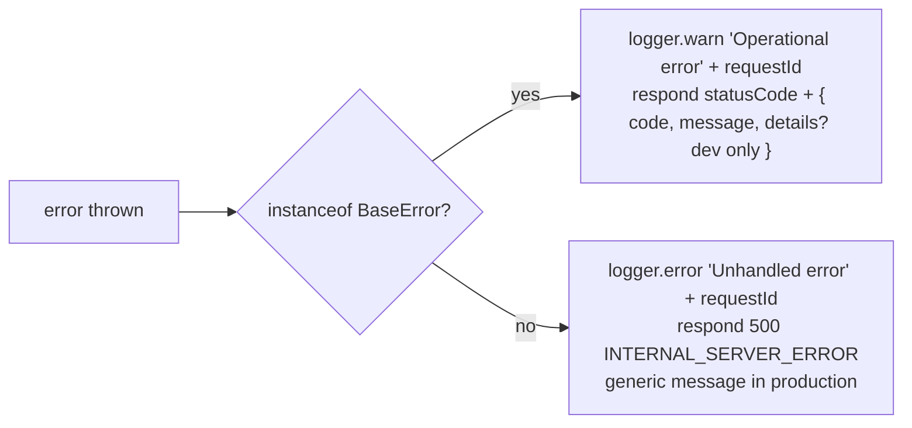

# Alternate.Me — Error Handling Reference

| Field | Value |
| --- | --- |
| **Project** | Alternate.Me — AI Digital Twin Platform |
| **Document** | `docs/ERROR-HANDLING.md` |
| **Version** | 1.1.0 |
| **Last Updated** | 2026-09-30 |
| **Status** | `Current` for implemented behaviour — §4.5 and §8 items 1–4, 6–7 describe the Phase 6 agent surface; §9 records open gaps |
| **Source of Truth** | Implementation: `backend/src/utils/errors.ts`, `backend/src/utils/response.ts`, `backend/src/middlewares/errorHandler.ts`, `backend/src/middlewares/notFound.ts`, `backend/src/knowledge/knowledge.errors.ts`, `backend/src/queues/index.ts`, `backend/src/utils/logger.ts`. Requirements: SRS v1.1. |

## Status label vocabulary

| Label | Meaning |
| --- | --- |
| `Current` | Implemented and present in the repository today. |
| `Planned` | Required by SRS v1.1 and assigned to a named, upcoming phase. Not implemented. |
| `Future` | Required by SRS v1.1 with no phase assigned yet. Not implemented. |
| `Engineering Decision` | A choice made during implementation that SRS v1.1 does not specify; recorded for review. |

> **Anti-invention rule:** nothing in this document asserts a requirement that is not present in SRS v1.1 or in the repository. Where behaviour is unspecified, the text says so explicitly.

## 1. Purpose and scope

The wire envelope (§2), the server-side error model (§3), the error-code catalogue (§4), business-to-HTTP mapping rules (§5), queue/worker retry policy (§6), logging and redaction (§7), Phase 6 guidance (§8), and known gaps with reporting rules (§9). Client-facing message text is never a source of truth for machine handling — the `error.code` is (`PHASES.md` §7 requires every error code referenced anywhere in the pack to be catalogued here in §4).

## 2. Response envelope contract (`Current`)

**Canonical success** (`apiResponse.success` / `paginated` / `created` / `accepted` in `src/utils/response.ts`):

```json
{ "success": true, "data": "<payload>", "meta": { "page": 1, "limit": 20, "total": 0, "totalPages": 0, "hasNext": false, "hasPrevious": false } }
```

`meta` appears on paginated responses only; `noContent` returns 204 with no body.

**Canonical error** (`apiResponse.error`, the central `errorHandler`, `notFoundHandler`):

```json
{ "success": false, "error": { "code": "VALIDATION_ERROR", "message": "…", "details": "<dev only>" } }
```

`details` is populated **only** when `NODE_ENV=development` (central handler); non-operational failures collapse to a fixed `"An unexpected error occurred"` message in production.

**Divergences tracked as G-04 (`Current`)** — clients must special-case these today:

| Emitter | Success shape | Error shape |
| --- | --- | --- |
| `apiResponse` (most routes) | `{ success, data, meta? }` | `{ success: false, error: { code, message, details? } }` |
| Memory controller (`src/memory/memory.controller.ts`) | `{ success: true, data }` — no `meta`; pagination is a bespoke `{ page, total, hasMore }` object | forwards errors to the central handler (canonical) |
| Chat controller (`src/chat/chat.controller.ts`) | `{ data }` only — no `success` | inline pre-checks answer bare `{ error: "…" }` **without** `code` (401/400/403); thrown errors reach the central handler (canonical) |
| Health endpoints / Swagger load | bespoke (`/health/*`) | `SWAGGER_ERROR` uses the canonical shape |

Unifying every handler on the canonical envelope is `Planned` and is a prerequisite for treating this section as a contract (`ARCHITECTURE.md` §9 note, G-04). Future areas — billing webhooks, analytics, moderation (`PHASES.md` traceability matrix, final row) — must emit the canonical shape from day one.

## 3. Error model (`Current`)

`BaseError` (`src/utils/errors.ts`) carries `statusCode`, a machine-readable `code`, `isOperational`, and optional `details`. The central `errorHandler` (`src/middlewares/errorHandler.ts`) branches on it:



`notFoundHandler` answers 404 `NOT_FOUND` for unknown routes (`Route <METHOD> <path> not found`). Zod failures are converted by `validate()` into `VALIDATION_ERROR` with per-field `details` (`{ path, message, code }[]` — `src/middlewares/validate.ts`).

**Class hierarchy** (all `isOperational = true` unless marked otherwise):

| Class | HTTP | Code | Typical raiser |
| --- | --- | --- | --- |
| `ValidationError` | 400 | `VALIDATION_ERROR` | `validate()`, memory content policy |
| `AuthenticationError` | 401 | `AUTHENTICATION_ERROR` | `authenticate`, refresh/reset flows |
| `AuthorizationError` | 403 | `AUTHORIZATION_ERROR` | role/permission/ownership guards, PRIVATE-alternate access |
| `NotFoundError` | 404 | `NOT_FOUND` | ownership masks, missing memory/session |
| `ConflictError` | 409 | `CONFLICT` | duplicate email/username |
| `BusinessError` | 422 | caller-supplied (default `BUSINESS_ERROR`) | `NO_PROVIDER_CONFIGURED`, `LLM_ERROR` |
| `RateLimitError` | 429 | `RATE_LIMIT_ERROR` | rate limiters |
| `DatabaseError` (non-operational) | 500 | `DATABASE_ERROR` | data layer |
| `StorageError` (non-operational) | 500 | `STORAGE_ERROR` | storage adapter |
| `AIError` (non-operational) | 502 | `AI_ERROR` | AI layer |
| `ProviderError` (non-operational) | 502 | `<PROVIDER>_ERROR` | outbound providers |
| `KnowledgeError` | per code | per code | ingestion (§4.3) — adds `isRetryable` + `safeMessage` |

`KnowledgeError` falls back to the `EXTRACTION_FAILED` spec for unknown codes; its `message` is guaranteed never to be a stack trace, and user-facing text is the code's `safeMessage` (`src/knowledge/knowledge.errors.ts`).

## 4. Error code catalogue

### 4.1 Core codes (also the memory API surface)

The table in §3 is the catalogue. The Phase 5 memory endpoints raise **only** core codes — `VALIDATION_ERROR` (empty/over-length content, policy failures, missing `content` on `/forget`), `NOT_FOUND` ("Memory not found", "Memory not found matching criteria"), plus middleware `AUTHENTICATION_ERROR` / `AUTHORIZATION_ERROR` (`src/memory/memory.controller.ts`, `memory.policy.ts`). Extraction and embedding failures are **not** HTTP errors: they are recorded as `memory_extraction_jobs.status = FAILED` with an error string and logged (`memory.extraction.failed`), and an LLM/parse failure returns an empty result so chat continues (`ED-05`, `DATABASE.md` §4.5). This is why `PHASES.md` maps Phase 5 to §4.1.

### 4.2 Chat / RAG codes (`Current`)

| Code | HTTP | Raised when |
| --- | --- | --- |
| `NO_PROVIDER_CONFIGURED` | 422 | The Alternate has no decodable BYOK key — fails fast before any LLM spend (`chat.service.ts`) |
| `LLM_ERROR` | 422 | The provider call failed or timed out; the message is always the generic "Failed to generate response. Please try again." — no provider internals cross the wire |

The chat controller's inline 401/400/403 pre-check responses use the bare `{ error }` shape — G-04, see §2.

### 4.3 Knowledge ingestion codes (`Current`)

`KNOWLEDGE_ERRORS` (`src/knowledge/knowledge.errors.ts`) — 19 codes; `isRetryable` drives the DB flag consumed by the retry worker (§6):

| Codes | HTTP | Retryable |
| --- | --- | --- |
| `UNSUPPORTED_FILE_TYPE`, `FILE_TOO_LARGE`, `CORRUPT_DOCUMENT`, `EMPTY_DOCUMENT`, `URL_BLOCKED`, `SSRF_BLOCKED`, `CONTENT_TOO_LARGE`, `INVALID_URL`, `OCR_REQUIRED`, `YOUTUBE_TRANSCRIPT_UNAVAILABLE`, `LINKEDIN_ACCESS_UNAVAILABLE` | 422 | no |
| `FETCH_TIMEOUT`, `FETCH_FAILED`, `EMBEDDING_PROVIDER_ERROR` | 502 | yes |
| `EXTRACTION_FAILED`, `CHUNKING_FAILED`, `EMBEDDING_FAILED` | 500 | yes |
| `SOURCE_NOT_FOUND` | 404 | no |
| `IDEMPOTENT_SKIP` | 200 | no — internal "unchanged" signal, not an error to clients |

### 4.4 Platform codes (`Current`)

`INTERNAL_SERVER_ERROR` (500, non-operational fallback), `RATE_LIMIT_ERROR` (429), `NOT_FOUND` (404, unknown routes), `SERVICE_UNAVAILABLE` (503, `/health/readiness` when the DB ping fails), `SWAGGER_ERROR` (500, Swagger spec load failure — canonical envelope).

### 4.5 Agent codes (`Current`, Phase 6)

Defined in `src/agent/agent.errors.ts` as a single `AGENT_ERRORS` spec table, mirroring `knowledge.errors.ts`: each entry fixes the HTTP status, the retry classification, the internal message and the user-safe message, so failures are never classified ad-hoc at a throw site. `AgentError extends BaseError`, so these codes flow through the existing `errorHandler` and the §2 envelope unchanged.

| Code | HTTP | Retryable | Category | Behaviour |
| --- | --- | --- | --- | --- |
| `AGENT_NOT_FOUND` | 404 | no | validation | Run/alternate not visible to this caller. Returned instead of 403 so another tenant's resource is indistinguishable from a missing one |
| `AGENT_DISABLED` | 422 | no | policy | `AGENT_ENABLED=false` or `alternate.agentEnabled=false`. No run row is created |
| `AGENT_UNAUTHORIZED` | 403 | no | authorization | Non-owner on a private Alternate, or a visitor reaching an owner-only tool |
| `AGENT_MAX_STEPS` | 422 | no | policy | Step ceiling reached; run persisted `FAILED` |
| `AGENT_MAX_TOOL_CALLS` | 422 | no | policy | Run-wide tool budget exhausted |
| `AGENT_MAX_LLM_CALLS` | 422 | no | policy | LLM-call budget exhausted |
| `AGENT_TIMEOUT` | 504 | **yes** | timeout | `AGENT_MAX_RUNTIME_MS` exceeded; run persisted `TIMED_OUT` |
| `AGENT_CONTEXT_LIMIT` | 422 | no | policy | Assembled context exceeded `AGENT_MAX_CONTEXT_TOKENS` |
| `AGENT_PROVIDER_UNAVAILABLE` | 502 | **yes** | provider | No provider configured, or the LLM call failed. Provider internals are never surfaced |
| `AGENT_RATE_LIMITED` | 429 | **yes** | rate_limit | Rate limiter tripped |
| `AGENT_EXECUTION_FAILED` | 500 | no | internal | Unclassified run failure; also the fallback code |
| `AGENT_RUN_CANCELLED` | 422 | no | policy | Reserved for cancellation |
| `TOOL_NOT_FOUND` | 404 | no | validation | Tool absent from the registry |
| `TOOL_DISABLED` | 422 | no | policy | Disabled for this Alternate via `ToolConfiguration` |
| `TOOL_INVALID_INPUT` | 400 | no | validation | Arguments failed the tool's `.strict()` Zod schema (missing, wrong type, unknown field, oversized, bad UUID) |
| `TOOL_NOT_ALLOWED` | 403 | no | authorization | Not permitted in this execution context, or a budget is exhausted |
| `TOOL_APPROVAL_REQUIRED` | 202 | no | approval | The run paused; the response carries `pendingApproval` |
| `TOOL_APPROVAL_REJECTED` | 422 | no | approval | Decision refused: already decided, expired, or a lost race |
| `TOOL_APPROVAL_NOT_FOUND` | 404 | no | validation | Approval absent, or belongs to another tenant |
| `TOOL_APPROVAL_EXPIRED` | 422 | no | approval | Past `AGENT_APPROVAL_TTL_MS`; marked `EXPIRED` |
| `TOOL_TIMEOUT` | 504 | **yes** | timeout | `AGENT_MAX_TOOL_RUNTIME_MS` exceeded; execution persisted `TIMED_OUT` |
| `TOOL_EXECUTION_FAILED` | 500 | no | internal | Tool threw; the safe message is persisted, never a stack trace |
| `TOOL_RESULT_INVALID` | 500 | no | internal | Tool output was `undefined` or not serialisable |

**Retry policy.** `src/agent/execution/retry-policy.ts` retries only transient classes (`TOOL_TIMEOUT`, `AGENT_TIMEOUT`, `AGENT_PROVIDER_UNAVAILABLE`, `AGENT_RATE_LIMITED`, `NETWORK_ERROR`, `ECONNRESET`, `ETIMEDOUT`, `EAI_AGAIN`, …) with exponential backoff (250 ms base, 4 s ceiling, 3 attempts). Terminal classes — `TOOL_INVALID_INPUT`, `TOOL_NOT_ALLOWED`, `AGENT_UNAUTHORIZED`, `FORBIDDEN`, `TOOL_NOT_FOUND`, `TOOL_APPROVAL_REJECTED`, `AGENT_MAX_STEPS` — are never retried. The `agent` BullMQ worker also drops terminal agent errors instead of consuming attempts.

**A failed tool does not necessarily fail the run.** Inside the loop, a tool error is converted into a sanitized untrusted-data result the model can react to, and the loop continues. For **authorization and approval denials** specifically, the payload tells the model not to retry and not to claim the action happened, so a denial cannot be negotiated away over subsequent turns. A single run can therefore end `COMPLETED` after a denied tool call.

## 5. Business-to-HTTP mapping (`Current`)

| Scenario | Response | Rule |
| --- | --- | --- |
| Unknown route | 404 `NOT_FOUND` | `notFoundHandler` |
| Foreign or missing owned resource (alternate, source, onboarding) | **404** `NOT_FOUND` — "not found or access denied" | `Engineering Decision`: ownership guards mask existence (§3) |
| Authenticated non-owner of a `PRIVATE` Alternate (chat) | **403** `AUTHORIZATION_ERROR` | `chat.service.ts` answers visibility explicitly rather than masking — a deliberate difference from the middleware; both behaviours are `Current` |
| Already-revoked session | 403 `AUTHORIZATION_ERROR` | `session.service.ts` |
| Duplicate verified email / username | 409 `CONFLICT` | registration |
| Rule-level failures — no provider key, LLM failure, ingestible-content refusals (unsupported type, blocked URL, empty document, …) | 422 | `BusinessError` family (§4.2) plus the §4.3 first group |
| Transient upstream failures — fetch timeout/failure, embedding provider | 502 | §4.3 second group — marked retryable for jobs (§6) |
| Parser/indexer failures inside the pipeline | 500 | §4.3 third group — retryable; users see `safeMessage` |
| Missing/invalid Bearer token; refresh or reset token reuse | 401 `AUTHENTICATION_ERROR` | §3–§4 |
| Limit exceeded (global, auth, chat) | 429 `RATE_LIMIT_ERROR` | `SECURITY.md` §3 |
| Readiness probe cannot reach the database | 503 `SERVICE_UNAVAILABLE` | `/health/readiness` |

Clients must branch on **status + `error.code`**, never on message text — messages are deliberately generic in production and not stable for machine handling (§2, §3).

## 6. Queue and worker retry policy (`Current`)

**Defaults on every queue** (`src/queues/index.ts`): `attempts: 3`, exponential backoff `delay: 2000` ms, `removeOnComplete: { age: 3600, count: 100 }`, `removeOnFail: { age: 86400, count: 1000 }`, worker concurrency `QUEUE_CONCURRENCY` (default 5).

| Mechanism | Behaviour | Reference |
| --- | --- | --- |
| Idempotent job ids | Deterministic keys (`mem-extract-<messageId>`, `memory-extract-<alternateId>-<messageId>`, `memory-embed-<memoryId>`) prevent duplicate work on producer retries | `chat.service.ts`, `memory.extraction.ts`, `memory.extraction.processor.ts` |
| Ingestion dual-retry | BullMQ `attempts: 3` with exponential backoff **plus** a durable DB `isRetryable` flag consumed by the `knowledge-retry` worker, which re-enqueues the job and marks the row `RETRYING`; `INGESTION_MAX_RETRIES` = 3 | `ED-06`, `ARCHITECTURE.md` §10 |
| Degradation instead of failure | Queues are created lazily; on Redis outage an `error` listener logs a warning and processing resumes on recovery; with `QUEUE_ENABLED=false` (or no `REDIS_URL`) the getter returns `null`, callers no-op, and work persists as `QUEUED` rows | `ED-04` |
| Connection fail-fast | `retryStrategy: () => null`, `enableOfflineQueue: false`, `maxRetriesPerRequest: null` — no reconnect storms inside a request | `src/queues/index.ts` |
| Worker failures | `failed` events log `{ jobId, err }`; the conversation-summary worker rethrows so BullMQ's attempt budget applies | `src/workers/*.worker.ts` |
| Graceful shutdown | Stop accepting HTTP → `closeAllQueues()` → `prisma.$disconnect()` → `exit(0)`, hard-capped by a 10 s timer | `ARCHITECTURE.md` §5 |
| HTTP-layer utility | `retry.execute` (3 attempts, exponential base 1 s, cap 10 s, + jitter) available for generic calls | `src/utils/helpers.ts` |

Durable job state that outlives Redis (`ingestion_jobs`, `memory_extraction_jobs` status + error columns) is documented in `DATABASE.md` §4.3 / §4.5 — the database, not the queue, is the record of truth for failed work.

## 7. Logging and redaction (`Current`, Phase 0)

- **Transport**: Pino at level `LOG_LEVEL` with ISO timestamps and `level` rendered as a label; `pino-pretty` locally (`src/utils/logger.ts`).
- **Redaction paths** (censor `[REDACTED]`): `req.headers.authorization`, `req.headers.cookie`, `body.password`, `body.token`, `body.secret`, `body.apiKey`, `body.api_key`, `*.apiKey`, `*.secret`, `*.password`.
- **Serializers**: request → `{ id, method, url, ip, userAgent }`; response → `{ statusCode, duration }`; errors via `pino.stdSerializers.err`. The request id is echoed as the `X-Request-Id` response header and attached by the central handler to every error log line.
- **Severity split**: a `BaseError` logs at `warn` as "Operational error"; anything else logs at `error` as "Unhandled error" with the stack (§3). Worker and queue events log `completed` / `failed` with job ids; rate-limit and validation failures therefore never inflate error-level noise.
- **Domain rules**: knowledge internals stay in logs while clients get `safeMessage` (§4.3); BYOK validation failures are logged without secrets; provider keys and decrypted key material are never logged (`SECURITY.md` §5); Prisma query logging is `debug`-level and off in production by default (`DATABASE.md` §8).
- **Never logged / never returned**: password hashes, raw one-time tokens, `encryptedApiKey`, and — pending encryption — OAuth provider tokens and `mfaSecret` (§9.2).

## 8. Phase 6 error guidance (`Current` for items 1–4, 6–7)

The Phase 6 catalogue is §4.5. What is implemented:

1. **Catalogue first — satisfied.** Every agent/tool/approval code is in §4.5, defined in one spec table (`src/agent/agent.errors.ts`) alongside its HTTP status and retry classification.
2. **Envelope — satisfied.** The nine agent endpoints emit the canonical §2 shape through the existing `errorHandler`; `AgentError extends BaseError`, so no new handler was added. Streaming is not implemented (§9, G-09).
3. **Approval denials are policy outcomes, not crashes — satisfied, with a deliberate deviation.** They surface as `TOOL_APPROVAL_REJECTED` (422) and `TOOL_NOT_ALLOWED` (403) rather than 500, and carry machine-readable reasons. **Deviation:** approval *pending* returns **202 Accepted** with a `pendingApproval` payload rather than 403, because pausing for a human is a success state, not a denial. A *rejected* approval is the 422.
4. **Retry philosophy mirrors ingestion (`ED-06`) — satisfied.** Bounded attempts (3), exponential backoff (250 ms → 4 s), explicit non-retryable classes (§4.5), and every tool execution persists its outcome and error code on the run/step records. The `agent` worker drops terminal errors instead of consuming attempts.
6. **Redaction by default — satisfied.** `tool_executions.input` is never written; only the redacted `sanitizedInput` is persisted. `failureMessage` / `errorMessage` store only the user-safe message — never a stack trace, provider payload or raw tool output. Audit metadata carries outcomes and flags (`truncated`, `redacted`, `neutralised`), not verbatim arguments. Channel payloads (email bodies, call recordings, transcriptions) remain `Future` and are covered by the same rule when they land.
7. **Budget exhaustion is distinguishable — satisfied.** Step/tool/LLM/context ceilings return 422 policy codes (`AGENT_MAX_STEPS`, `AGENT_MAX_TOOL_CALLS`, `AGENT_MAX_LLM_CALLS`, `AGENT_CONTEXT_LIMIT`), distinctly from a provider outage (502 `AGENT_PROVIDER_UNAVAILABLE`) and from rate limiting (429).

Still `Future` / `Planned`:

5. **Webhook and signature failures** (Twilio, Stripe, inbound email) will answer 401/403 with dedicated codes and must not be retried client-side. No such endpoint exists yet.
8. **Future-area endpoints** (billing, analytics, moderation) adopt §2 from day one rather than adding new shapes — the divergence in §2 must not grow.

## 9. Known gaps and reporting rules

### 9.1 Verification blocker (`Current` statement of an open gap — G-01)

**Corrected diagnosis.** This section previously attributed the test failures to Vitest `@` alias resolution. That was wrong. During Phase 6 it was established that:

- The alias resolves correctly — a Phase 6 suite importing through `@/agent/...` throughout executes and passes 96 assertions.
- The real blocker is **database connectivity**. `src/tests/setup.ts` is a global `setupFiles` entry and runs `prisma.$queryRaw\`SELECT 1\`` in `beforeAll`, so an unreachable database aborts **every** suite before any assertion, and Vitest reports the tests as *skipped* rather than failed. In the current environment `DATABASE_URL` points at an unreachable Neon pooler host.

**Reporting rule.** Phase 5, and Phase 6's DB-backed behaviour, must be described as **"Implementation complete — automated verification blocked by unavailable database; DB-backed tests authored but not executed."** They must **not** be described as tested, verified, or passing. Phase 6's unit scope (96 tests, `pnpm test:agent`) **was** executed and may be described as tested with counts stated. Every error path in §4.1 and §4.5 that depends on persistence is therefore unverified. Remediation and prerequisites are `PHASES.md` §5.1–§5.2. This section is `ARCHITECTURE.md` G-01's cross-reference target.

### 9.2 Sensitive values must never cross the error boundary (`Current` rule; open hardening)

`OAuthAccount.accessToken` / `refreshToken` / `idToken` and `User.mfaSecret` are **plaintext at rest today** (`DATABASE.md` — this section is the `ERROR-HANDLING.md` §9 pointer used by the `oauth_accounts` row). Until they are encrypted (`SECURITY.md` §8 items 1–2), they are extra dangerous in errors and logs: they must never be placed in `error.details`, `error.message`, audit metadata, or any log line. The development-only `details` passthrough (§2) must never be fed these fields, and any repository error that could embed a database row must be mapped to a generic code first. Encrypting these columns remains a required hardening item tracked in `SECURITY.md` §8.

### 9.3 Envelope divergence (`Current` — G-04)

The three coexisting success/error shapes documented in §2 mean this document currently *describes* rather than *contracts* the wire format; unifying all handlers on the canonical envelope is `Planned` and tracked as G-04 in `ARCHITECTURE.md` §13. Clients integrating today must read §2's divergence table first.

---

*End of ERROR-HANDLING.md — version 1.1.0.*


