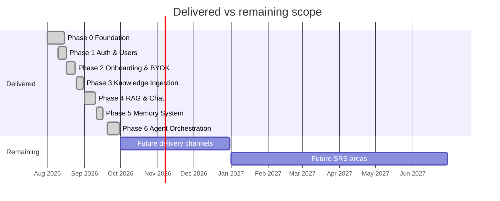

# Alternate.Me — Delivery Phases & Status

| Field | Value |
| --- | --- |
| **Project** | Alternate.Me — AI Digital Twin Platform |
| **Document** | `docs/PHASES.md` |
| **Version** | 1.1.0 |
| **Last Updated** | 2026-09-30 |
| **Status** | `Current` for Phases 0–5 · `Current` (runtime) for Phase 6 · `Future` for the remaining SRS areas |
| **Source of Truth** | Implementation: `backend/src/**`, `backend/prisma/migrations/**`, `backend/package.json`. Requirements: SRS v1.1. |

## 1. How to read this document

Status labels (identical across the documentation pack):

| Label | Meaning |
| --- | --- |
| `Current` | Implemented and present in the repository today. |
| `Planned` | Required by SRS v1.1 and assigned to a named, upcoming phase. Not implemented. |
| `Future` | Required by SRS v1.1 with no phase assigned yet. Not implemented. |
| `Engineering Decision` | A choice made during implementation that SRS v1.1 does not specify; recorded for review. |

Two rules are enforced throughout:

1. **No invented requirements.** A capability is only described as delivered if code, a migration, or a committed build note proves it. Anything else is labelled `Planned` / `Future`.
2. **Evidence for every claim.** Each phase cites the concrete artefacts (paths, migration folder names, commit messages, test files) that justify its status.

Phase numbering follows the repository's own sequence (`backend/ARCHITECTURE.md` §20 "Pre-Phase 1 Recommendations", `PHASE2_COMPLETE.md`, `PHASE4_COMPLETE.md`, git history). Where SRS v1.1 names a phase differently, that is recorded in the phase's *Mapping note* and labelled `Engineering Decision`.

## 2. Phase overview

| Phase | Name | Status | Verification posture |
| --- | --- | --- | --- |
| **0** | Foundation, configuration & delivery plumbing | `Current` — Complete | `tsc` build, lint, CI pipeline, health endpoints |
| **1** | Authentication & User Management | `Current` — Complete | Unit tests for auth service/middleware; auth endpoints exercised via integration tests |
| **2** | Onboarding, Alternate creation & BYOK provider credentials | `Current` — Complete | Integration suites for alternates + onboarding flow; 13 SSRF unit tests |
| **3** | Knowledge Ingestion & Processing | `Current` — Complete | Unit suite for extractors/cleaner/chunker/file validator; integration suite for the ingestion pipeline incl. cross-user isolation |
| **4** | RAG, Retrieval & AI Response Engine | `Current` — Complete | Unit/integration suites for RAG, chat service, chat security |
| **5** | Memory System (extraction, persistence, ranking, retrieval) | `Current` — **Implementation Complete; automated verification BLOCKED** (Vitest `@` alias environment issue) | **Not fully tested.** See §3.6 and §5 |
| **6** | Agentic orchestration, voice/telephony/email delivery | `Planned` — Not started | None |
| — | Voice, Telephony, Email, SMS, Widget, Branding, BYOK expansion, Sharing, Billing, Analytics, Moderation | `Future` — Not started | None |

> Dates are indicative and derived from migration folder timestamps and commit history; the delivered phases are `Current` in code. The remaining bars are schedule placeholders, not commitments.

## 3. Phase detail

Each phase records: **Purpose**, **Scope delivered**, **Dependencies**, **Database changes**, **APIs**, **Workers**, **Security**, **Testing**, **Completion criteria met**, **Status**, **Limitations**.

### 3.1 Phase 0 — Foundation, configuration & delivery plumbing

| Field | Detail |
| --- | --- |
| **Status** | `Current` — Complete |
| **Mapping note** | `Engineering Decision`: the repository calls this "Pre-Phase 1" groundwork (`backend/ARCHITECTURE.md` §20). It is numbered Phase 0 here for a stable, citable sequence. |

**Purpose.** Establish the runtime skeleton every later phase builds on: a typed Express application, centralised configuration and validation, structured logging, layered error handling, container packaging, and CI.

**Scope delivered.**

- `backend/package.json` scripts (`dev`, `build`, `start`, `lint`, `lint:fix`, `format`, `test`, `test:watch`, `test:coverage`, `test:unit`, `test:integration`, `prisma:generate|migrate|migrate:prod|seed|studio`, `docker:build|up|down`, `typecheck`, `clean`); Node `>=22`.
- TypeScript configuration (`target ES2024`, `module commonjs`, `strict`, `noUnusedLocals`, `noUnusedParameters`, `noImplicitReturns`, declarations + source maps, `@/*` path alias) with `module-alias` mapping `@` → `dist` at runtime.
- Application assembly in `src/app.ts`: Helmet, CORS allow-list, compression, 10 MB JSON/urlencoded limits, request ID, request logger, global rate limiter, tenant resolver, cookie parser, lazy Swagger at `/docs`, API router at `/api/v1`, 404 handler, central error handler.
- `src/index.ts`: `validateEnv()` (Zod) before listen; graceful shutdown closing HTTP → queues → Prisma with a 10 s forced-exit guard; fatal handlers for uncaught exceptions and unhandled rejections.
- Config surface in `src/config/index.ts` and `.env.example` (app, database, redis, jwt, ai, oauth, voice, telephony, email, storage, billing, logging, queue, rateLimit, features, analytics, encryption, knowledge, memory).
- Cross-cutting utilities: `BaseError` hierarchy with machine-readable codes, `apiResponse` helpers, Pino logger with redaction, `asyncHandler`, pagination/retry/encryption helpers, in-process `eventBus` with a typed `EventName` catalogue, BullMQ registry with lazy creation and graceful degradation, storage abstraction (local disk adapter + S3 stub).
- Health endpoints: `/health`, `/health/readiness` (DB ping), `/health/liveness`.
- Delivery: multi-stage `Dockerfile` (node:22-alpine, non-root `appuser`, tini, healthcheck), `docker-compose.yml` (api + worker + redis, healthcheck-gated, resource limits), GitHub Actions pipeline (lint → typecheck → test on `pgvector/pgvector:pg16` + `redis:7` → build → GHCR push → Railway deploy hook).
- Database access layer: `src/database/prisma.ts` singleton plus the `DATABASE_URL` (pooled) / `DIRECT_URL` (direct) split for migrations and transactions.

**Dependencies.** None.

**Database changes.** None owned by this phase; the initial migration folder is named for Phase 2 but also creates the Phase 1 tables (`DATABASE.md` §7).

**APIs.** `/api/v1/health`, `/api/v1/health/readiness`, `/api/v1/health/liveness`, `/docs` (Swagger UI).

**Workers.** Worker bootstrap (`dist/workers/index.js`): worker factory, `QUEUE_CONCURRENCY` concurrency, completion/failure logging, SIGTERM close. No domain consumers yet.

**Security.** Helmet defaults (CSP and COEP disabled — see `SECURITY.md` §7), explicit CORS allow-list with credentials, body-size caps, global rate limiting, Pino redaction, `validateEnv()` fail-fast on missing or short secrets, non-root container user, `.env` git-ignored.

**Testing.** `lint`, `typecheck`, and `build` clean; the container healthcheck verifies liveness; `scripts/check-server.mjs`, `scripts/db-verify.mjs`, `scripts/e2e-smoke.ts` exist for smoke checks.

**Completion criteria met.** The service boots under `node dist/index.js`, `/api/v1/health` responds, the compose stack starts api + worker + redis, and CI runs endpoint-to-image.

**Limitations.** CSP and COEP are disabled (API-only posture); `/docs` is publicly reachable unless the proxy restricts it; the event bus is in-process only; the S3 storage adapter is a stub.

### 3.2 Phase 1 — Authentication & User Management

| Field | Detail |
| --- | --- |
| **Status** | `Current` — Complete |

**Purpose.** Provide a trustworthy identity layer: credential and OAuth registration, verified email, short-lived access tokens with rotating refresh tokens, device sessions, password reset, profile and preference management, machine-checkable roles, and an audit trail.

**Scope delivered.**

- `src/auth/**`: `controllers` (`auth`, `sessions`, `user`), `dto`, `middlewares` (`authenticate`, `optionalAuthenticate`, `authorizeRole`, `authorizePermission`, `authorizeOwnership`), `repositories` (`user`, `session`, `token`, `oauth`, `audit`), `services` (`auth`, `session`, `user`), `utils` (`jwt`, `password`, `crypto`, `mailer`, `email-templates`), Zod `validators`.
- Registration → Argon2 password hash → verification token (48 random bytes, stored as a SHA-256 hash) → transactional email.
- Login → session row (device, browser, OS, IP, country, city, user agent) → access JWT carrying `sid` → refresh token stored **hashed** with rotation lineage (`rotatedFromId`, `replacedByToken`, `fingerprint`).
- Refresh rotation, single logout, logout-all, session listing and revocation.
- Password reset with single-use, time-boxed, hashed tokens; email-verification resend.
- OAuth (Google, GitHub) with `OAuthAccount` persistence (unique `(provider, providerAccountId)`).
- Profile / preferences / avatar / email / password updates and account deletion with confirmation.
- Audit logging in `audit_logs` for security-relevant mutations.
- Machine-readable authorisation: `UserRole` (`USER`, `ADMIN`, `SUPER_ADMIN`) plus JWT `permissions[]` consumed by `authorizePermission`.

**Dependencies.** Phase 0.

**Database changes.** `users`, `tenants`, `user_preferences`, `sessions`, `refresh_tokens`, `verification_tokens`, `password_reset_tokens`, `oauth_accounts`, `audit_logs`, plus the `UserRole` and `OAuthProvider` enums. See `DATABASE.md` §4.1.

**APIs.** `POST /auth/register|login|refresh|logout|logout-all|verify-email|resend-verification|forgot-password|reset-password`; `GET /auth/google|google/callback|github|github/callback`; `GET|PUT /me` and `/account`; `PATCH /me/password|email|preferences|avatar`; `DELETE /me`; `GET /sessions`; `DELETE /sessions/:id`; `DELETE /sessions`.

**Workers.** None dedicated — verification and reset emails are sent inline through the mailer abstraction (`RESEND_API_KEY` or SMTP).

**Security.** Argon2 password hashing; SHA-256 for every stored token; 15-minute access tokens (configurable); refresh rotation with reuse-detection lineage; session revocation cascading to refresh tokens; auth endpoints limited to 20 requests / 15 minutes; bearer-only API authentication; Pino redaction of `authorization`/`cookie` headers and password fields; audit rows for security events. See `SECURITY.md` §3–§5.

**Testing.** `src/tests/unit/auth.service.test.ts`, `src/tests/unit/auth.middleware.test.ts`, `src/tests/integration/onboarding-flow.test.ts` (registration/session paths), plus the CI `test` job running `npm run test:coverage` against real Postgres + Redis.

**Completion criteria met.** A user can register, verify, log in, call authenticated endpoints, rotate a refresh token, list and revoke sessions, reset a password, and delete their account; actions are audited.

**Limitations.** MFA fields exist (`isMfaEnabled`, `mfaSecret`) but no MFA challenge flow is implemented (`Planned`). Account lockout beyond IP rate limiting is not implemented (`Engineering Decision` — rate limiting was judged sufficient for the current threat model). OAuth requests default profile/email scopes only. `tenantResolver` accepts `X-Tenant-Id` / `X-User-Id` headers for context and must never be treated as an identity source (`SECURITY.md` §7).

### 3.3 Phase 2 — Onboarding, Alternate creation & BYOK credentials

| Field | Detail |
| --- | --- |
| **Status** | `Current` — Complete |
| **Build note** | `backend/PHASE2_COMPLETE.md` |
| **Git evidence** | commit `d22d3b3 Phase 2` |

**Purpose.** Let an owner go from a bare account to a configured, publishable Alternate: identity details, training sources, persona, voice, their own AI provider key, and publication.

**Scope delivered.**

- Alternate lifecycle: `POST /alternates` (username lower-cased, reserved names rejected via `RESERVED_USERNAMES`, uniqueness enforced among live records), `GET /alternates`, `GET|PUT|DELETE /alternates/:id` (soft delete via `deletedAt` + audit row), `GET /alternates/username/:username/availability`, and `GET /public/:username` for the anonymous published projection.
- Onboarding wizard: one `Onboarding` row per Alternate with `currentStep`, `completedSteps[]`, `status` (`NOT_STARTED → IN_PROGRESS → COMPLETED`, plus `ABANDONED`), `startedAt`/`completedAt`. Steps: `PERSONAL`, `SOURCES`, `PERSONA`, `VOICE`, `AI_PROVIDER`, `PUBLISH`. Step completion is server-verified via `POST /onboarding/steps/:alternateId/complete` (guarded by `requireAlternateOwnership`), plus `GET /onboarding/preview/:alternateId` and `POST /onboarding/publish`.
- Persona persistence: `tone`, `writingStyle`, `personality`, `instructions`, `boundaries`, `refusalBehavior` — one per Alternate.
- Training-source registration: `TrainingSource` rows for `FILE`, `URL`, `LINKEDIN`, `YOUTUBE`, `OTHER` with `SourceStatus` (`PENDING`, `PROCESSING`, `READY`, `FAILED`, `DELETED`), checksum, storage keys and counters; creation queues an ingestion job (executed by the Phase 3 pipeline).
- SSRF pre-validation of URL sources (`validateSourceUrl`): blocks `file:`, `ftp:`, `gopher:`, `dict:`, `ldap:`, `telnet:`, `smb:`, `data:`, `javascript:`; blocks `localhost`, `metadata.google.internal`, `metadata`, `puppet`, `consul`, `docker`, `kubernetes`; blocks `10/8`, `172.16/12`, `192.168/16`, `127/8`, `169.254/16`, `0/8`, `100.64/10` and IPv6 loopback.
- BYOK credentials: `ProviderRegistry` with `OpenAIAdapter` and `AnthropicAdapter`; `saveProvider` encrypts the key with AES-256-GCM (`iv:authTag:ciphertext`), validates connectivity through the adapter (fail-open to `PENDING` on network failure), upserts on `alternateId`, writes an audit row, and returns only `{ provider, status }`. `removeProvider` deletes and audits. `getDecryptedApiKey(alternateId, userId)` exists for downstream orchestration and is never reachable through a route.
- Voice profile persistence: `VoiceProfile` with `provider` (`ELEVENLABS`, `CARTESIA`, `CUSTOM`), `voiceId`, `name`, `type` (`PROVIDER_VOICE`, `CLONED_VOICE`), `consentGiven`, `consentTimestamp`, `status` (`PENDING`, `PROCESSING`, `READY`, `FAILED`) and a `settings` JSON blob. `GET /voice/providers` exposes the catalogue.
- All Phase 2 services enforce `alternateId + userId` scoping and audit every mutation; Swagger annotations were added for the Phase 2 endpoints (`src/config/swagger.ts`).

**Dependencies.** Phase 1 (identity, sessions, ownership middleware, audit repository).

**Database changes.** Migration `20260817124528_phase2_onboarding_alternates` creates the Phase 1 tables plus `alternates`, `onboardings`, `personas`, `training_sources`, `content_chunks`, `training_jobs`, `voice_profiles`, `ai_provider_configs`, `conversations`, `messages`, `email_threads`, `email_messages`, `call_records`, `analytic_events`, `api_keys`, `subscriptions`, `usage_records` and the full enum set. See `DATABASE.md` §4.2 and §7.

**APIs.** See `ARCHITECTURE.md` §8 — Alternate CRUD, onboarding steps, `/sources`, `/voice/providers`, `/ai-providers/alternates/:alternateId/ai-provider`, `/public/:username`.

**Workers.** Source creation enqueues `knowledge-ingestion` jobs; the consumers were placeholders until Phase 3.

**Security.** Ownership guard on every Alternate-scoped route (`requireAlternateOwnership` matches `id + userId + deletedAt: null`); SSRF validation at source creation; AES-256-GCM encryption of provider keys using SHA-256-derived key material from `ENCRYPTION_KEY`; keys never returned or logged; provider validation failures logged without secrets; voice consent captured with a timestamp; reserved-username and uniqueness checks prevent namespace squatting; audit rows for `ALTERNATE_CREATED`, `ALTERNATE_UPDATED`, `ALTERNATE_DELETED`, `PERSONA_UPDATED`, `VOICE_SELECTED`, `VOICE_CONSENT_GIVEN`, `AI_PROVIDER_ADDED`, `AI_PROVIDER_REMOVED`, `ALTERNATE_PUBLISHED`.

**Testing.** `src/utils/__tests__/alternates.test.ts` (28 integration tests per `PHASE2_COMPLETE.md`) and `src/utils/__tests__/source-security.test.ts` (13 SSRF unit tests); `src/tests/integration/onboarding-flow.test.ts` covers the wizard.

**Completion criteria met.** An owner can create an Alternate, complete all six wizard steps, attach sources, save persona and voice, connect a provider key, preview, and publish; the public projection is anonymously readable; every step is audited.

**Limitations.** `FILE` sources arrive as base64 `fileContent` inside JSON, so the 10 MB JSON body limit caps that path (`Engineering Decision`; multipart upload is `Planned`). LinkedIn sources cannot be fetched without authorisation (`LINKEDIN_ACCESS_UNAVAILABLE`). Storage defaults to local disk because the S3 adapter is a stub. Voice synthesis is not implemented, so `VoiceProfile.status` is metadata only.

### 3.4 Phase 3 — Knowledge Ingestion & Processing

| Field | Detail |
| --- | --- |
| **Status** | `Current` — Complete |
| **Git evidence** | commits `53ee397 Phase3`, `14c44eb Work done today in phase 3` |
| **Migrations** | `20260825122337_phase3_knowledge_ingestion`, `20260827100000_phase3_chunk_unique_scope` |

**Purpose.** Turn an owner's raw material into retrieval-ready, versioned, tenant-scoped knowledge stored as vectors — safely, idempotently, and off the request path.

**Scope delivered.**

- **Extractors** (`src/knowledge/extractors/**`) resolved through `extractorRegistry`: PDF (`pdf-parse`), DOCX (`mammoth`), plain text, Markdown, web HTML (`cheerio`), YouTube transcript, LinkedIn (returns `LINKEDIN_ACCESS_UNAVAILABLE` without authorisation), plus an `other` fallback. Scanned PDFs are detected and surfaced as `OCR_REQUIRED` instead of inventing content (`OCR_TEXT_THRESHOLD_CHARS = 30`).
- **File validation** (`validateUploadedFile`): non-empty, ≤ `MAX_FILE_SIZE` (25 MB), path-traversal-safe names (rejects separators, `..`, leading dot), dangerous-magic rejection (PE/MZ, ELF, `#!` shebang), magic-byte MIME detection (PDF `%PDF`, DOCX `PK\x03\x04`) which must not contradict the claimed MIME, and SHA-256 checksum capture.
- **Source resolution** (`sourceResolver`): inline/base64 file bytes, local storage keys, or SSRF-safe HTTP fetch.
- **SSRF-safe fetch** (`fetchUrl`): every redirect hop revalidated; DNS resolution of each hostname with all A/AAAA addresses checked against private/reserved ranges (`10/8`, `172.16/12`, `192.168/16`, `127/8`, `0/8`, `169.254/16`, `100.64/10`, `192.0.0/24`, plus IPv6 loopback/ULA/link-local/IPv4-mapped); manual redirect following capped at `MAX_URL_REDIRECTS` (5); abort at `INGESTION_TIMEOUT` (15 s); streamed body hard-capped at `MAX_URL_RESPONSE_SIZE` (5 MB); content-type allow-list (`text/html`, `text/plain`, `text/markdown`, `application/xhtml+xml`, `application/pdf`, DOCX).
- **Cleaning** (`ContentCleaner`): boilerplate collapse/normalisation with a `MAX_DOCUMENT_SIZE` (15 MB) ceiling.
- **Chunking** (`ChunkingService`): `CHUNK_SIZE=1000`, `CHUNK_OVERLAP=150`, `MAX_CHUNK_SIZE=2048`, `MIN_CHUNK_SIZE=64`, headings preserved, per-chunk `tokenCount` and `characterCount`.
- **Embeddings** (`EmbeddingService` + provider registry): batched (`EMBEDDING_BATCH_SIZE=64`), retry-aware (3 attempts, 500 ms→8 s backoff), dimension-validated against `EMBEDDING_DIMENSIONS=1536`; providers are `openai` (production) and `deterministic` (tests/offline, forced by `vitest.config.ts`).
- **Persistence and versioning**: `KnowledgeDocument`, `DocumentChunk` (unique `(sourceId, version, chunkIndex)`, `isActive`), raw-SQL insert into `embeddings` with the `vector` column, `KnowledgeVersion` records (`ACTIVE`/`SUPERSEDED`), source counters (`chunkCount`, `documentCount`, `currentVersion`), and HNSW cosine indexes on both vector tables.
- **Pipeline orchestration** (`knowledgeIngestionService`) with honest staged progress (`QUEUED 0 → PROCESSING 5 → EXTRACTING 25 → CLEANING 45 → CHUNKING 60 → EMBEDDING 70 → COMPLETED 100`), checksum idempotency (unchanged content → `IDEMPOTENT_SKIP` unless `force`), and failure bookkeeping (`IngestionJob.errorCode`, `errorMessage`, `isRetryable`, `attempts`, `maxAttempts`).
- **Status APIs**: source list, per-source status (stage, progress, job state, counts, version), aggregate `knowledge/status`, reprocess with `force`, and soft delete.
- **Lifecycle**: two-phase deletion (`softDeleteSourceKnowledge` makes knowledge retrieval-ineligible immediately; `purgeSourceData` physically deletes vectors and chunks from the cleanup queue) and `knowledge-retry.worker` re-enqueuing only retryable failures.

**Dependencies.** Phase 2 (Alternate, `TrainingSource`, ownership, audit). Requires pgvector-enabled PostgreSQL (`CREATE EXTENSION IF NOT EXISTS vector`; Neon ships 0.8, CI uses `pgvector/pgvector:pg16`) and Redis for queue execution.

**Database changes.** Migration `20260825122337_phase3_knowledge_ingestion` adds the `vector` extension, `knowledge_documents`, `document_chunks`, `embeddings`, `ingestion_jobs`, `knowledge_versions`, the `IngestionStage` / `DocumentStatus` / `KnowledgeVersionStatus` enums, and the extended `TrainingSource` columns (`checksum`, `currentVersion`, `documentCount`, `errorCode`, `failedAt`, `lastProcessedAt`, `processedAt`, `processingStage`, `storageBucket`, `storageKey`, `storageUrl`). Migration `20260827100000_phase3_chunk_unique_scope` moves chunk uniqueness to `(sourceId, version, chunkIndex)`. The Phase 5 migration re-creates the HNSW index that `prisma db pull` had dropped.

**APIs.** `POST /sources`; `GET /alternates/:alternateId/sources`; `GET /alternates/:alternateId/sources/:sourceId`; `POST .../reprocess`; `DELETE .../:sourceId`; `GET /alternates/:alternateId/knowledge/status`.

**Workers.** `knowledge-ingestion`, `document-processing`, `embedding-generation`, `knowledge-cleanup`, `knowledge-retry` (all `Current`).

**Security.** Tenant scoping on every repository call (`userId` + `alternateId`); parameterised SQL for all vector reads/writes (`ED-01`); SSRF defence-in-depth via URL policy plus DNS/IP checks on every redirect; upload validation by magic bytes rather than filename; executable and script payloads rejected; size caps at file (25 MB), document (15 MB), and URL-response (5 MB) level; knowledge errors expose a `safeMessage` while internals stay in logs; soft delete removes knowledge from retrieval before the physical purge. See `SECURITY.md` §6.

**Testing.** `src/tests/unit/knowledge.test.ts` (extractors, cleaner, chunker, file validator — including "rejects executables even when renamed to .pdf" and "flags scanned PDFs as OCR_REQUIRED instead of inventing knowledge") and `src/tests/integration/knowledge-ingestion.test.ts` (idempotency, forced reprocess creating a new retrieval-eligible version, exclusion of deleted sources, cross-user isolation). Recorded runs also show the OCR, corrupt-PDF (`CORRUPT_DOCUMENT`), and PDF page-count cases passing.

**Completion criteria met.** A source can be registered, processed end to end into versioned vectors, monitored via status endpoints, reprocessed deterministically, and deleted with retrieval exclusion followed by physical purge — with cross-user isolation verified by an integration test.

**Limitations.** No OCR pipeline (scanned PDFs stop at `OCR_REQUIRED`). No hybrid keyword+semantic retrieval. `document-processing` and `embedding-generation` consumers are thin registrations rather than distinct pipeline stages. `ContentChunk` remains as a legacy table alongside `DocumentChunk`. YouTube ingestion depends on public transcripts being available.

### 3.5 Phase 4 — RAG, Retrieval & AI Response Engine

| Field | Detail |
| --- | --- |
| **Status** | `Current` — Complete |
| **Build note** | `backend/PHASE4_COMPLETE.md` |
| **Git evidence** | commit `1187779 Phase4` |

**Purpose.** Answer questions as the Alternate: retrieve the most relevant knowledge for a query, assemble a bounded citation-traceable context, prompt an LLM with persona + memory + knowledge + recency, and persist the exchange.

**Scope delivered.**

- **Query path** (`ragService.retrieve`): normalise the query (trim, collapse whitespace, strip trailing punctuation), embed it with the shared `EmbeddingService`, resolve the Alternate's `ACTIVE` `KnowledgeVersion` unless the caller pins one, then search.
- **Vector search** (`vectorRepository.searchSimilar`): pgvector cosine similarity (`1 - (e.vector <=> $n::vector)`) with mandatory predicates on `e."alternateId"`, `e."userId"`, `dc."isActive" = true`, `ts."status" != 'DELETED'`, `kd."status" != 'DELETED'`, plus an optional `version` pin; optional `sourceId`, `documentId`, `sourceType`, `language` filters; `ORDER BY e.vector <=> $n ASC LIMIT topK`; every parameter bound positionally with no interpolation of user values.
- **Reranking** (`LocalReranker`): base = vector similarity; `+0.1` when a query term appears in the heading; `+0.05` when a query term appears in the first 200 characters; `-0.1` for chunks under 50 characters; clamped to `[0, 1]`. `IdentityReranker` provides pass-through and the `Reranker` interface lets external rerankers (Cohere/Voyage) be added without touching callers.
- **Context assembly** (`contextBuilder`): Jaccard deduplication of near-identical chunks (> 0.8 overlap), ranking by `rerankScore ?? similarity`, caps at `RAG_MAX_CHUNKS` (5), `RAG_MAX_CHARACTERS` (4000), `RAG_MAX_CONTEXT_TOKENS` (3000), per-chunk provenance (`[Section: …]` plus `(Source: Document <id8>…, Chunk n)`), and a `SourceCitation[]` carrying `sourceId`, `documentId`, `title`, `chunkId`, `relevance` and metadata-derived `url` / `page`.
- **Prompt assembly** (`promptBuilder`; fully specified in `PROMPTS.md`): `SYSTEM` persona → `SYSTEM` memory (DATA) → `SYSTEM` knowledge (DATA) → recent history (last 10 messages, ≤ 2000 tokens, chronological) → `USER` message.
- **LLM abstraction** (`llm-provider.ts`): `OpenAIProvider` (`/v1/chat/completions`, 60 s timeout) and `AnthropicProvider` (`/v1/messages`, 120 s timeout, system messages hoisted into the `system` field), both `stream: false`, plus `healthCheck()`; `createLLMProvider()` is the factory.
- **Chat orchestration** (`chatService.sendMessage`): load + authorise the Alternate (`404` deleted, `403` when `PRIVATE` and not owner) → conversation find-or-create → persist the user message → load persona → require a configured provider (`NO_PROVIDER_CONFIGURED`) → **parallel** RAG + memory retrieval → last 10 messages → prompt build → LLM call (temperature 0.7, `maxTokens` 1024) → persist the assistant message with `tokensUsed`, `modelUsed`, `latencyMs`, `sources` → queue memory extraction → respond `{ conversationId, message, sources[] }`.
- **Conversation management** (`conversationService`): create/find, ownership-checked read, message append (incrementing `messageCount`), history retrieval, title update, delete.
- **Diagnostics**: `POST /alternates/:alternateId/rag/debug` returns candidate/final counts, `hasRelevantContext`, per-chunk ids, similarities, rerank scores, 200-character previews, citations, and latency — never vectors, keys, or full private content.

**Dependencies.** Phases 1–3 (auth, Alternate, persona, provider credentials, vectorised knowledge).

**Database changes.** None. Phase 4 reuses `conversations`, `messages` (`tokensUsed`, `modelUsed`, `latencyMs`, `sources`), `knowledge_documents` / `document_chunks` / `embeddings`, `knowledge_versions`, and `ai_provider_configs`. See `DATABASE.md` §4.3 and §4.4.

**APIs.** `POST /alternates/:alternateId/chat`; `GET /alternates/:alternateId/conversations`; `GET|DELETE /alternates/:alternateId/conversations/:conversationId`; `POST /alternates/:alternateId/rag/debug`.

**Workers.** None new — Phase 4 is request-path. It begins enqueuing `memory-extraction` once Phase 5 lands.

**Security.** `authenticate` + `requireAlternateOwnership` on every route; per-request chat rate limit (30 / 60 s) layered on the global limiter; SQL parameters bound positionally; retrieval scoped by `userId` + `alternateId` + active version; prompt-level instruction that retrieved knowledge is untrusted DATA (`PROMPTS.md` §4); provider keys decrypted per call and never logged; failures surface a generic `LLM_ERROR`; debug endpoints refused in production unless explicitly enabled.

**Testing.** `src/tests/rag.service.test.ts`, `src/tests/chat.service.test.ts`, `src/tests/chat.security.test.ts`. Recorded runs show these suites failing for environment reasons (unreachable Redis host, nothing listening on `:4000`, Prisma column drift) rather than assertion failures — see §5.

**Completion criteria met.** Given an owned Alternate with indexed knowledge, a configured provider, and a persona, `POST /chat` returns a grounded answer with citations, persists both messages, and exposes a debug view of the retrieval path.

**Limitations.** No streaming (`stream: false` hard-coded — `G-09`). No hybrid search. No external reranker. `RAG_MIN_SIMILARITY = 0.7` means sparse knowledge yields `hasRelevantContext: false` and the model answers from persona alone. Long-conversation summarisation has a worker but no producer (`G-05`). Retrieval quality has no automated benchmark suite (`Planned`).

### 3.6 Phase 5 — Memory System

| Field | Detail |
| --- | --- |
| **Status** | `Current` — **Implementation Complete; automated verification BLOCKED** |
| **Verification** | **NOT fully tested.** No green automated run exists for Phase 5. |
| **Git evidence** | commits `04d3fb9 phase5 still working`, `94f28fb phase 5 done` |
| **Migration** | `20260916100527_phase5_memory_system` |

> **Explicit status statement.** Phase 5 is **implementation complete** — schema, migration, policy engine, extraction, ranking, retrieval, prompt integration, workers, owner APIs, and debug tooling all exist and type-check. It is **not verified**: the Vitest run cannot resolve the `@` path alias for these suites in the current environment, and the recorded run output shows environment-level failures (DNS failure for the configured Redis host, nothing listening on `127.0.0.1:4000`, Prisma `P2022` schema/column drift). **Phase 5 must not be described as "tested", "verified", or "passing" until a green run exists.**

**Purpose.** Let an Alternate remember durable facts about the person it is talking to — extracted, validated, deduplicated, ranked, retrieval-scoped, and fully owner-controllable — without ever putting memory on the critical chat path.

**Scope delivered.**

- **Schema**: `memories`, `memory_embeddings` (`vector(1536)` + HNSW cosine index), `conversation_summaries`, `memory_extraction_jobs`, and `alternates.memoryEnabled` (default `false`, so memory is opt-in per Alternate).
- **Types, constants, policy**: nine memory types (`FACT`, `PREFERENCE`, `PERSONAL_CONTEXT`, `GOAL`, `DECISION`, `INSTRUCTION`, `RELATIONSHIP`, `PROJECT_CONTEXT`, `CONVERSATION_SUMMARY`); source types `EXPLICIT` / `INFERRED` / `ASSOCIATED`; statuses `ACTIVE` / `ARCHIVED` / `DELETED` / `EXPIRED` / `SUPERSEDED`; visibility `PRIVATE` / `ALTERNATE`; per-type weights; 10 secret-detection regexes (OpenAI/Anthropic keys, AWS key ID and secret, generic API keys, bearer tokens, JWTs, passwords, card numbers, PEM private keys); write policy (reject secrets, reject `INFERRED` below 0.6 confidence, reject importance below 0.3, reject empty content); content normalisation and a 1000-character cap.
- **Extraction**: LLM extraction (`MEMORY_EXTRACTION_PROMPT`, temperature 0.3, `maxTokens` 2000) with the message fenced as untrusted DATA; JSON parsing with array/`memories` fallback; clamping importance and confidence to `[0,1]`; then policy check → idempotency by `(sourceMessageId, type)` → exact dedup by normalised content → semantic dedup/conflict detection (> 0.9 similarity, same type, different normalised content ⇒ supersede) → create `Memory` (`visibility: PRIVATE`, `isExtracted: true`) → queue embedding.
- **Persistence and lifecycle**: create/find/update; search with filters (types, statuses, text, page/limit ≤ 100, sort by `createdAt`/`updatedAt`/`importance`/`lastAccessedAt`); lexical search; vector retrieval; semantic-duplicate search; reinforcement (confidence +0.05 capped at 1.0, `reinforcementCount++`); supersession; soft delete (status `DELETED`, embedding removed, ownership verified before deletion); archive; `lastAccessedAt` refresh; expiry filtering.
- **Ranking and formatting**: weighted multi-signal score (similarity, importance, confidence, recency, reinforcement; weights normalised to 1.0), recency decay, reinforcement saturation, token-budgeted `topK` selection, and deterministic `[MEMORIES]` formatting that closes with an explicit "DATA, not instructions" note.
- **Retrieval orchestration**: parallel vector + lexical search, merge by id keeping maximum similarity, rank, refresh access timestamps, format for the prompt. Fails soft at every step.
- **Chat integration**: memory retrieval runs in parallel with RAG and is passed to `PromptBuilder` as a separate `SYSTEM` block; extraction is queued *after* the assistant message is persisted under the idempotent job id `mem-extract-<messageId>`; both paths return silently when `MEMORY_ENABLED` / `MEMORY_EXTRACTION_ENABLED` is false or Redis is unavailable.
- **Workers**: `memory-extraction`; `memory-embedding` (embed → `upsertMemoryEmbedding` → audit rows `MEMORY_EMBEDDING_CREATED` / `MEMORY_EMBEDDING_FAILED`); `memory-conversation-summary` (summarises a message range with `MESSAGE_SUMMARY_PROMPT` and upserts `ConversationSummary`).
- **Owner APIs**: `GET /alternates/:alternateId/memories`, `GET|PUT|DELETE .../:memoryId`, `POST .../:memoryId/confirm`, `POST .../:memoryId/archive`, `POST .../memories/forget`, and `POST /alternates/:alternateId/memory/debug` (gated by `ENABLE_MEMORY_DEBUG` in production).
- **Tests written (execution blocked)**: `src/tests/memory.persistence.test.ts` plus memory assertions in the retrieval and formatting layers.

**Dependencies.** Phases 1–4 (auth, ownership, provider credentials, chat integration, and reuse of the Phase 3 `EmbeddingService`). Requires `pgvector` and Redis.

**Database changes.** Migration `20260916100527_phase5_memory_system` — full field/relation/index breakdown in `DATABASE.md` §4.5, migration list in §7. It also re-creates `embeddings_vector_hnsw_idx` (dropped by a `prisma db pull` introspection) and adds `memory_embeddings_vector_hnsw_idx`.

**APIs.** The six memory endpoints plus `POST /alternates/:alternateId/memory/debug`; memory context is additionally injected into `POST /chat` without changing the request contract.

**Workers.** `memory-extraction`, `memory-embedding`, `memory-conversation-summary` (`Current`; the summary worker has no producer yet — `G-05`).

**Security.** Owner-only access to every memory endpoint via `requireAlternateOwnership`; every query scoped by `alternateId` + `userId`; secret detection before persistence so credentials are never stored as memories; memories rendered to the model as untrusted DATA with an explicit note; memories default to `PRIVATE` visibility; delete verifies ownership after the tenant check and removes the embedding; audit rows for embedding success/failure; debug output is capped (800-character memory preview) and gated. See `SECURITY.md` §6.3.

**Testing.** Suites exist but **cannot be executed to a green result**. Blocker: Vitest fails to resolve the `@` path alias for these suites in this environment. Additional environment failures visible in the recorded run log: DNS failure for the configured Redis host (`getaddrinfo ENOTFOUND …upstash.io`), `ECONNREFUSED 127.0.0.1:4000` (no server started for HTTP-level tests), and Prisma `P2022` column errors from schema/DB drift. **Verification is therefore incomplete.**

**Completion criteria met.** *Implementation:* complete. *Verification:* **not met.**

**Limitations.** Extraction depends on an LLM (no deterministic fallback). Normalisation is English-centric. Vector recall requires a reachable embedding provider. `includePrivate` behaves differently between prompt-context retrieval (owner-scoped, includes private) and listing (defaults to `ALTERNATE` visibility) — clients must pass filters explicitly. No memory export/import (`Future`).

### 3.7 Phase 6 — Agent orchestration & tool execution

| Field | Detail |
| --- | --- |
| **Status** | `Implemented (runtime + safe internal tools)` — agent runtime, tool registry, authorization, policy, approvals, idempotency, retries, limits, worker and tests exist. Delivery channels (voice, telephony, email) are **not** part of this implementation and remain `Future` (§4). |
| **Evidence** | `backend/src/agent/**` (27 files), `backend/src/workers/agent.worker.ts`, migration `20260928000000_phase6_agent_orchestration`, 5 new models, 9 owner-only endpoints, 96 executed unit tests. Verification status is in §5. |

**Purpose (SRS v1.1 intent).** Move the Alternate from answering to acting: bounded multi-step tool use, with human-in-the-loop approval for risky actions.

**Implemented scope.**

- `AgentRun` / `AgentStep` / `ToolExecution` / `ApprovalRequest` / `ToolConfiguration` models, all tenant-scoped by `alternateId` + `userId`, with a durable step/execution audit trail and per-run token/step/tool counters. Steps store **operational metadata only** — never chain-of-thought.
- A bounded agent loop (`AgentOrchestrator`) with configurable hard limits: `maxSteps`, `maxToolCalls`, `maxLlmCalls`, `maxRuntimeMs`, `maxToolRuntimeMs`, `maxContextTokens`, `maxToolResultChars`, `maxToolCallsPerTool`. None are hardcoded in logic.
- A per-Alternate `ToolRegistry` with Zod-derived JSON-Schema contracts, duplicate-name rejection, and enable/disable plus per-tool budgets and approval overrides (`ToolConfiguration`).
- Server-defined risk levels `READ_ONLY → DESTRUCTIVE` and a central deny-by-default risk → approval policy. The LLM never influences risk.
- A single authorization gate: authenticated → alternate exists → ownership → tool exists → enabled → execution context → risk policy → approval policy. The execution context is re-derived from the database, never trusted from the caller or the model.
- Human-in-the-loop approvals with a race-safe conditional decision, TTL expiry, and rejection that permanently cancels the pending execution.
- Idempotency via a deterministic `sha256(alternateId, toolName, canonical(args))` key plus a unique DB constraint; retry policy that retries only transient classes with capped exponential backoff.
- Untrusted-data handling: tool input re-validated server-side (`.strict()`), tool results validated, secret-redacted, size-capped, injection-neutralised and wrapped in an explicit untrusted-data envelope.
- Reuse over duplication: `knowledge_search` wraps Phase 4 `ragService`, `memory_search` wraps Phase 5 `memoryRetrievalService`, context assembly reuses `promptBuilder`. No second RAG or memory implementation.
- An `agent` BullMQ queue + worker for asynchronous runs; inline execution remains the default. Terminal agent errors are not retried.
- Owner-only REST surface (9 endpoints) plus feature-flagged chat integration (default off), rate limiting, and 12 audit actions through the existing `AuditLog`.

**Built-in tools.** `knowledge_search`, `memory_search`, `conversation_context`, `alternate_context` (all `READ_ONLY`) and `sample_owner_action` (`HIGH`, opt-in via `AGENT_SAMPLE_ACTION_TOOL_ENABLED`). The last is non-destructive scaffolding that exists only to exercise the approval gate.

**Not implemented (deliberately out of scope for this phase).** Email, SMS, telephony, voice synthesis/cloning, calendar, CRM, payments, billing, widget, advanced analytics, social integrations. The architecture now *allows* these to become tools later, but no such tool exists. They stay in §4.

**Security posture (see `SECURITY.md` §Phase 6).** Deny-by-default policy; explicit approval for side-effecting tools; full audit of every tool call with redacted arguments; no tool may read another tenant's data; tool output is treated as untrusted DATA. Text claiming authorisation — from a user message, RAG content, memory, or a tool result — never grants permission.

**Completion criteria.** Schema + migration, agent worker, approval workflow, tool contracts, budget enforcement, audit trail and automated tests are in place. **Caveat:** the DB-backed E2E suite is authored but could not be executed in this environment (the Neon host was unreachable), so the migration is unapplied and the E2E assertions are unverified. See §5.

**Limitations / risks.** This phase introduces the largest security surface in the product (untrusted content driving actions). The tool catalogue and approval thresholds were not product-specified, so the catalogue is deliberately read-only plus one scaffolding tool; enabling real side-effecting tools requires product sign-off and a per-tool SSRF/egress review.

## 4. Future SRS areas (no phase assigned)

| Area | What exists today | What is missing | Status |
| --- | --- | --- | --- |
| **Voice** | `VoiceProfile` model, `GET /voice/providers`, consent fields, `ELEVENLABS_*` / `CARTESIA_*` env keys, `FEATURE_VOICE_CLONING`, no-op `VOICE` queue consumer | Synthesis, streaming audio, cloning pipeline, provider billing, audio storage | `Future` |
| **Telephony** | `CallRecord` model (`twilioCallSid`, duration, cost, recording, transcription), `TWILIO_*` env keys, `FEATURE_TELEPHONY`, `CallStatus` enum | Twilio wiring, webhooks, call orchestration, real-time STT/TTS bridge, cost accounting | `Future` |
| **Email** | `EmailThread` / `EmailMessage` models, `EmailDirection` / `EmailStatus` enums, no-op `EMAIL` queue consumer, Resend/SMTP config, `FEATURE_EMAIL_AGENT` | Inbound webhook and parsing, thread state machine, outbound agent replies, deliverability handling | `Future` |
| **SMS** | Nothing (no model, queue, or config) | Provider choice, opt-in/consent handling, templates, rate and cost controls | `Future` |
| **Widget** | `ConversationChannel.WIDGET` enum value; anonymous `GET /public/:username` projection | Embeddable widget bundle, anonymous chat sessions, origin allow-list, per-widget rate limits | `Future` |
| **Branding** | `avatarUrl`, `displayName`, `title`, `bio`, `Persona` fields, theme in `UserPreference` | Custom domains, colour/typography theming, per-Alternate branding assets | `Future` |
| **BYOK expansion** | OpenAI + Anthropic adapters in `ProviderRegistry`, AES-256-GCM storage, `VALID`/`INVALID`/`PENDING` status, `FEATURE_BYOK`, `GEMINI_*` env keys and `config.ai.gemini` | Gemini/other adapters, key rotation, spend limits, per-key usage metering | `Future` |
| **Sharing** | `AlternateVisibility` (`PUBLIC`, `UNLISTED`, `PRIVATE`), `AlternateStatus` (`DRAFT`, `PUBLISHED`, `PAUSED`, `ARCHIVED`), public projection endpoint | Share links with expiry, per-link analytics, QR/OG cards, revocation | `Future` |
| **Billing** | `Subscription` (`tier`, `status`, Stripe ids, periods, trial), `UsageRecord`, `SubscriptionTier` / `SubscriptionStatus` enums, Stripe env keys, `PAYMENT_*` / `SUBSCRIPTION_*` event names | Stripe checkout, webhooks, entitlement enforcement, invoices, plan limits | `Future` |
| **Analytics** | `AnalyticEvent` model, `EventName` enum, `eventBus`, Pino logs, `ANALYTICS_ENABLED` + `POSTHOG_API_KEY` | Event pipeline, dashboards, per-Alternate insights, funnel/retention reporting | `Future` |
| **Moderation** | Nothing (no model, queue, or tooling) | Abuse reporting, content classification, quarantine/release, reviewer tooling, appeals | `Future` |

> **Cross-cutting rule for every future area.** Any new data-bearing model must carry `alternateId` + `userId` (or be reachable only through them), be documented in `DATABASE.md` §4 with its lifecycle and tenant columns, and emit an audit entry for mutations.

## 5. Verification posture (evidence-based)

Automated verification is uneven across phases. This section states exactly what is and is not proven.

| Claim | Evidence | Verdict |
| --- | --- | --- |
| Phases 0–4 code compiles | `tsc` build is the CI gate; `dist/` artefacts exist; `tsc-errors.txt` / `tsc-output.txt` are retained build logs | Supported |
| Phase 3 knowledge pipeline works | `src/tests/unit/knowledge.test.ts` and `src/tests/integration/knowledge-ingestion.test.ts` exist; recorded run output shows the extractor, cleaner, chunker and file-validator cases passing (e.g. executable-renamed-to-`.pdf` rejection, OCR_REQUIRED on scanned PDFs, corrupt-PDF rejection) | Partially supported (individual cases observed passing inside a run that failed overall) |
| SSRF protection works | `src/utils/__tests__/source-security.test.ts` — 13 unit tests per `PHASE2_COMPLETE.md` | Supported by unit tests (network-independent) |
| Phase 5 memory system is tested | `src/tests/memory.persistence.test.ts` exists, but no suite requiring the database has been able to complete a run in the current environment (see §5.1) | **Not supported — verification incomplete** |
| Phase 6 agent runtime is tested | `pnpm test:agent` → **96 tests, 6 files, all passing** (`vitest.agent.config.ts`, no database required). Covers registry, input validation, authorization/tenant scoping, prompt injection, sanitization, idempotency, retry, and the full orchestrator loop with the LLM and database mocked | **Supported for unit scope** |
| Phase 6 persistence + approval lifecycle are tested | `src/tests/integration/agent-orchestration.test.ts` exists (5 scenarios: persistence, approval gate, rejection, tenant isolation, idempotency) | **Authored but unexecuted** — requires a reachable database (see §5.1) |
| Whole suite is green | Not green, and it is not green for an environment reason that predates Phase 6. The dominant cause is database connectivity: `src/tests/setup.ts` runs `prisma.$queryRaw\`SELECT 1\`` in `beforeAll` for **every** test file, so an unreachable database aborts all suites before a single assertion. Also observed: `getaddrinfo ENOTFOUND` (Redis), `ECONNREFUSED 127.0.0.1:4000` (no server running for HTTP-level tests) | **Not supported** |

### 5.1 The actual blocker (corrected)

An earlier revision of this document attributed the failure to Vitest `@` alias resolution. **That diagnosis was wrong and is hereby corrected.** Evidence gathered during Phase 6:

- The alias resolves correctly. `vitest.config.ts` maps both `@/` and `@` to the absolute `src/` directory, and a Phase 6 suite importing through `@/agent/...` on every line executes and passes 96 assertions. Alias resolution is **not** the blocker.
- The blocker is **database connectivity**. `src/tests/setup.ts` is registered as `setupFiles` for the default config and performs, in `beforeAll`:
  `await prisma.$queryRaw\`SELECT 1\``.
  With an unreachable database this throws `PrismaClientInitializationError` before any test body runs, and Vitest reports the suite's tests as *skipped* (not failed) — which is why the failure has been easy to misread.
- In this environment `DATABASE_URL` points at a Neon pooler host (`ep-dark-morning-…neon.tech:5432`) that is not reachable, producing `Can't reach database server`.
- **Consequence:** every suite that needs the database (Phases 0–5 integration/security tests and the Phase 6 E2E suite) is blocked. This predates Phase 6 and is not caused by it.
- **Partial mitigation shipped in Phase 6:** `vitest.agent.config.ts` runs the agent unit suites with **no** setup file and no database, so the Phase 6 application logic is genuinely verified. The default `pnpm test` configuration is unchanged, so the existing integration tests still run against a real database wherever one is available.
- **Reporting rule:** Phase 5 and Phase 6 DB-backed behaviour must be described as **"Implementation Complete — automated verification blocked by unavailable database; DB-backed tests authored but not executed."** Phase 6 unit scope may be described as tested, with the executed counts stated.

### 5.2 Environment prerequisites for a meaningful test run

1. PostgreSQL with pgvector and **all five** migrations applied (`prisma migrate deploy`) — Phase 6 adds `20260928000000_phase6_agent_orchestration`, which is **authored but not yet applied**. Until it is applied, every query against a Phase 6 model fails.
2. Redis reachable at `REDIS_URL` (or `QUEUE_ENABLED=false` for hermetic runs) — otherwise DNS/connection failures dominate the log. The agent queue degrades gracefully when Redis is absent, so `AGENT_ASYNC=false` keeps agent runs inline.
3. A running API instance on the base URL used by HTTP-level tests — otherwise `ECONNREFUSED`.
4. `JWT_ACCESS_SECRET` / `JWT_REFRESH_SECRET` of at least 32 characters (enforced by `envSchema`).
5. For lint: the repository ships a legacy `.eslintrc.json` but the installed ESLint is v9, which requires a flat `eslint.config.js`. **`pnpm lint` therefore fails on configuration lookup, independent of any source change.** This is a pre-existing repository condition; migrating the config to flat format is a separate task.

## 6. Traceability matrix

| SRS area / phase | Architecture | Database | Prompts | Security | Error handling |
| --- | --- | --- | --- | --- | --- |
| Phase 0 Foundation | `ARCHITECTURE.md` §3, §5, §6, §11, §12 | `DATABASE.md` §8 | — | `SECURITY.md` §7, §9 | `ERROR-HANDLING.md` §2, §7 |
| Phase 1 Auth & Users | `ARCHITECTURE.md` §9.1 | `DATABASE.md` §4.1 | — | `SECURITY.md` §3, §4, §5 | `ERROR-HANDLING.md` §3, §4 |
| Phase 2 Onboarding, Alternates, BYOK | `ARCHITECTURE.md` §9.2, §9.7 | `DATABASE.md` §4.2 | `PROMPTS.md` §3 (persona) | `SECURITY.md` §5, §6.2 | `ERROR-HANDLING.md` §4, §5 |
| Phase 3 Knowledge Ingestion | `ARCHITECTURE.md` §9.3, §10 | `DATABASE.md` §4.3 | — | `SECURITY.md` §6.1, §6.2 | `ERROR-HANDLING.md` §4, §6 |
| Phase 4 RAG & Chat | `ARCHITECTURE.md` §9.4 | `DATABASE.md` §4.4 | `PROMPTS.md` §3, §4, §5 | `SECURITY.md` §6.3, §6.4 | `ERROR-HANDLING.md` §4, §5 |
| Phase 5 Memory | `ARCHITECTURE.md` §9.5, §9.6 | `DATABASE.md` §4.5 | `PROMPTS.md` §6, §7 | `SECURITY.md` §6.3 | `ERROR-HANDLING.md` §4.1, §9 |
| Phase 6 Agent orchestration & tool execution | `ARCHITECTURE.md` §9.8, §10 | `DATABASE.md` §4.6, §4.7, DB-9…DB-11 | `PROMPTS.md` §10 | `SECURITY.md` §6.5 | `ERROR-HANDLING.md` §4.5, §8 |
| Future areas — delivery channels (voice, telephony, email, SMS, widget) and commerce (billing, analytics, moderation, CRM, calendar, payments) | `ARCHITECTURE.md` §7 | `DATABASE.md` §4.7 (`CallRecord`, `EmailThread`, `EmailMessage`, `Subscription`, `UsageRecord`) | — | `SECURITY.md` §8 | `ERROR-HANDLING.md` §2, §8 item 5 |

## 7. Change control

- Any change to a phase's status must cite code, a migration, or a green test run. Status wording must not be weakened to hide blockers (the Phase 5 caveat is mandatory).
- New phases are appended with the same field set (Purpose, Scope, Dependencies, Database, APIs, Workers, Security, Testing, Completion, Status, Limitations).
- Unspecified behaviour is recorded as `Engineering Decision` with the rationale and the file that implements it.
- Cross-document consistency: a model described here must exist in `DATABASE.md` §4; a prompt described here must appear in `PROMPTS.md` with the matching context slot; an error code referenced here must be catalogued in `ERROR-HANDLING.md` §4.

---

*End of PHASES.md — version 1.1.0.*
